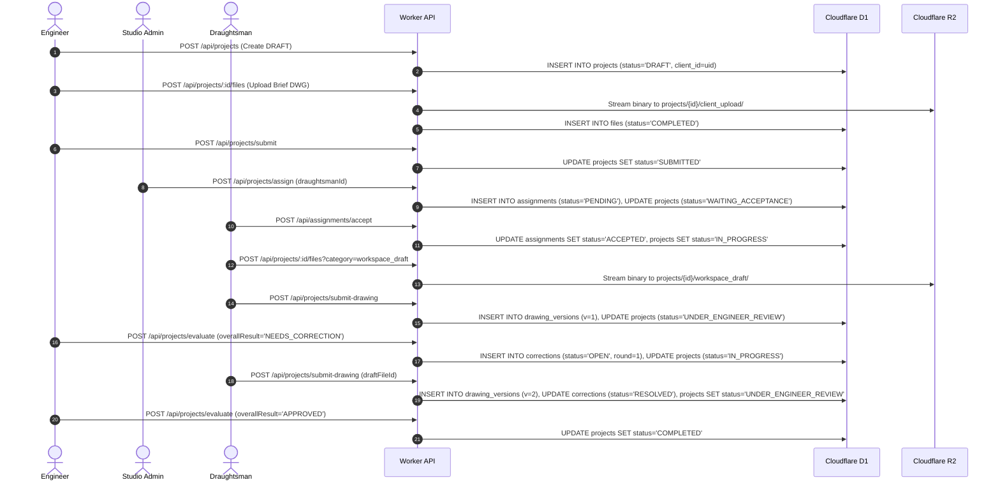

# ARCHI DRAFT — MASTER INTEGRATION & SYSTEM ARCHITECTURE GUIDE

**Repository Root:** `D:\PROJECT\Archidraft-integration-workspace`
**Git Branch:** `COMPLETED-INTERGRATION` (HEAD: `f21fb29`)
**Delivery Branch Target:** `COMPLETED-INTERGRATION` (All work staged and ready for manual review; commits and push held strictly pending owner approval)
**System Architecture:** Flutter Multiplatform Client (Web, Desktop, Android) + Next.js Admin Studio + Cloudflare Worker API (Hono) + Cloudflare D1 (Relational SQLite) + Cloudflare R2 (Object Storage) + Firebase Auth (Cryptographic Identity Verification) + PIXMINT BOT 2.0 Integration

---

## 1. Project Overview

**ARCHI DRAFT** is an enterprise-grade architectural and technical drawing production platform connecting Engineers/Clients, Professional Draughtsmen, CAD Academy Students, and Studio Administrators in a secure, role-governed workflow.

### Architecture Highlights
- **Client Application:** Flutter (Dart 3.4+ / Flutter 3.22+) using Riverpod 2.x for reactive state management and GoRouter for declarative, role-guarded, fail-closed navigation. Includes embedded PIXMINT AI Chatbot drawer.
- **Studio Admin Application:** Next.js 14 / React application (`apps/admin-web/`) providing executive dashboard metrics, user directories, project assignment dispatch, practical evaluation queues, live activity feeds, and the PIXMINT BOT Control Center.
- **Backend Edge API:** Cloudflare Worker running Hono with strict server-side middleware for Firebase token verification, DPDP-compliant Terms of Service gating, activity logging, and row-level data access control.
- **Database Layer:** Cloudflare D1 (`archi-draft-db`), a globally distributed relational SQLite database storing users, projects, drawing versions, assignments, evaluations, notifications, activity logs, and legal consent audits across 17 schema migrations.
- **File Storage:** Cloudflare R2 (`archi-draft-storage`), housing CAD files (`.dwg`, `.dxf`), architectural briefs, revision markups, and digitally signed PDF training certificates.
- **Identity Provider:** Google Firebase Authentication providing cryptographically signed RS256 JWT tokens. Supports dual-environment configuration (Production: `archi-draft`, Staging: `archi-draft-staging`).
- **AI Assistant Integration:** PIXMINT BOT 2.0 provides contextual prompt suggestions, telemetry, knowledge source governance, and responsive chat assistance across both Flutter and Admin portals.

### Persona Panels
1. **Engineer Panel (Client):** Allows architects and structural engineers to draft project briefs, specify drawing requirements (scale, area, delivery timeline), submit projects to the Studio pool, review submitted revisions, annotate drawings with structured corrections, approve final drawings, and chat with PIXMINT BOT.
2. **Draughtsman Panel:** Enables professional CAD operators to view incoming studio assignments, accept or reject workloads, maintain private cloud workspace drafts, submit formal versions (`draughtsman_version`), review engineer markups, and resolve correction rounds.
3. **Student Panel:** Facilitates CAD Academy learning through curriculum modules, lesson completion tracking, practical project submissions, evaluator feedback review, verified credential generation, and public digital portfolio showcase.
4. **Studio Admin Panel:** Administration workspace dedicated to operational management: project assignments, reassignments, draughtsman pool monitoring, student evaluations, digital credential issuance, live activity feeds, platform legal policy publication, and PIXMINT BOT configuration.

---

## 2. Repository Map

```text
Archidraft-integration-workspace/
|-- apps/
|   -- admin-web/                        # Next.js 14 Studio Admin Portal (Port 3000)
|       |-- public/images/                # Static assets (including pixmint-bot-logo.jpeg)
|       |-- src/
|       |   |-- app/                      # Next.js App Router (dashboard, projects, activity, settings)
|       |   |-- components/               # Admin UI components, layout, and PixmintBotControlCenter
|       |   -- lib/                      # api.ts (normalized client) and firebase.ts configuration
|       -- test/                         # Node.js automated test suites (151 passed across 36 suites)
|-- lib/                                  # Flutter Client Application Source (Port 8080)
|   |-- main.dart                         # Application entrypoint & Riverpod initialization
|   |-- firebase_options.dart             # Compile-time Firebase config (STAGING=true: staging, default: prod)
|   -- src/
|       |-- core/                         # Core routing, theme, and network infrastructure
|       |-- features/
|       |   |-- auth/                     # Firebase Auth state, login & provisioning screens
|       |   |-- engineer/                 # Engineer portal screens (projects, briefs, reviews)
|       |   |-- draughtsman/              # Draughtsman portal screens (studio, workspace, CAD viewer)
|       |   |-- student/                  # Student portal reservation & training curriculum
|       |   |-- api/                      # ApiClient reading API_URL environment variable
|       |   -- legal/                    # DPDP Act & IT SPDI legal onboarding, center & privacy
|-- scratch/
|   -- pixmint-bot/                      # PIXMINT BOT Flutter Package (Floating sheet & dark chat input)
|-- test/                                 # Flutter Automated Test Suites (304 tests verified)
|-- worker/                               # Cloudflare Worker Backend Source (Port 8787)
|   |-- src/
|   |   |-- index.ts                      # Hono API router, business logic, activity logging & middleware
|   |   |-- auth.ts                       # Firebase JWKS token verification
|   |   -- legal.ts                      # DPDP legal routes, terms assertion gate & consent ledger
|   |-- migrations/                       # D1 SQLite relational migrations (0001 through 0017)
|   -- test/                             # Node.js backend integration test harness (281 passed across 34 suites)
-- docs/                                 # Architectural specifications, contracts & handover reports
```

---
## 3. Engineer Panel Guide

- **Primary Route:** `#/engineer/projects` (Navigates to `EngineerProjectsScreen`)
- **Key Screens:**
  - `engineer_projects_screen.dart`: Tabbed project listings (`All`, `Drafts`, `In Progress`, `Under Review`, `Completed`).
  - `project_form_screen.dart`: Multi-step project creation wizard (`DRAFT` creation, requirement specification, brief upload).
  - `project_detail_screen.dart`: Detailed timeline, CAD drawing viewer, version comparison, and reviewer actions.
  - `engineer_activity_screen.dart`: Filtered audit log of events on owned projects.
- **State Providers (`lib/src/features/projects/providers/project_providers.dart`):**
  - `engineerProjectsProvider`: Streams projects where `client_id == uid`.
  - `projectDetailProvider(id)`: Fetches project metadata.
  - `projectDrawingVersionsProvider(id)`: Lists formal submitted versions.
  - `projectCorrectionsProvider(id)`: Retrieves active and historical correction rounds.
- **Workflow & Rules:**
  1. Creating a project via `POST /api/projects` stores it in `DRAFT` status.
  2. Engineer uploads reference sketches via `POST /api/projects/:id/files?category=client_upload`.
  3. Submitting via `POST /api/projects/submit` transitions status to `SUBMITTED`, queuing it for Admin assignment.
  4. Once a draughtsman submits work (`UNDER_ENGINEER_REVIEW`), Engineer evaluates via `POST /api/projects/evaluate`:
     - `APPROVED`: Completes project, notifies draughtsman.
     - `NEEDS_CORRECTION`: Increments `correction_round`, sets project back to `IN_PROGRESS`, records correction items.
     - `REJECTED`: Cancels project.

---

## 4. Draughtsman Panel Guide

- **Primary Route:** `#/draughtsman/studio` (Navigates to `DraughtsmanStudioScreen`)
- **Key Screens:**
  - `draughtsman_studio_screen.dart`: Overview of assigned tasks, active drawings, and pending assignments.
  - `draughtsman_assignment_detail_screen.dart`: Review project brief, scope, and accept/reject actions.
  - `draughtsman_workspace_screen.dart`: Working CAD canvas, upload working drafts, review engineer corrections.
  - `draughtsman_drawings_screen.dart`: Library of all past and present drawing deliveries.
  - `draughtsman_insights_screen.dart`: Performance analytics (average revision rounds, on-time delivery rate).
- **State Providers (`lib/src/features/projects/providers/assignment_providers.dart`):**
  - `draughtsmanAssignmentsProvider`: Queries `GET /api/assignments`, strictly filtered to the authenticated draughtsman.
- **Workflow & Rules:**
  1. Draughtsman reviews assignment in `WAITING_ACCEPTANCE`.
  2. Accepts via `POST /api/assignments/accept` (transitions project to `IN_PROGRESS`) or rejects via `POST /api/assignments/reject`.
  3. Draughtsman uploads working drafts via `POST /api/projects/:id/files?category=workspace_draft`.
  4. Draughtsman can delete their own drafts via `DELETE /api/projects/:id/files/:fileId`.
  5. Submitting formal delivery via `POST /api/projects/submit-drawing` creates a new entry in `drawing_versions` (`version_number` incremented) and sets project to `UNDER_ENGINEER_REVIEW`. Submitted versions cannot be deleted by non-admins.

---

## 5. Student Panel Guide

- **Primary Route:** `#/student/dashboard` (Navigates to `StudentStudioScreen` embedded in `StudentShell`)
- **Key Screens:**
  - `student_training_screen.dart`: Interactive curriculum browser with module cards and completion meters.
  - `training_module_detail_screen.dart` & `lesson_screen.dart`: Markdown lesson viewers and exercise instructions.
  - `student_projects_screen.dart` & `student_project_workspace_screen.dart`: Practical drafting projects assigned by Studio Admin.
  - `student_portfolio_screen.dart`: Showcase of completed, approved practical projects with rubric scores.
  - `student_credentials_card.dart`: Digital certificates with QR verification links.
- **Workflow & Rules:**
  1. Student completes theory lessons via `POST /api/student/training/lessons/:id/progress`.
  2. Studio Admin assigns a practical training project (`is_training_project = 1`).
  3. Student drafts drawing in CAD workspace and submits via `POST /api/projects/submit-drawing`.
  4. Admin reviews submission via `POST /api/projects/evaluate`.
  5. Upon approval (`APPROVED`), D1 atomically records completion, generates a cryptographic verification token, and allows certificate PDF generation (`POST /api/student/credentials/:id/certificate`).
  6. Certificate can be verified by any third party without authentication via `GET /api/public/credentials/verify/:token` or on the web at `#/verify/:token`.

---

## 6. Complete Workflow Map



---

## 7. Authentication & Account Isolation Architecture

### A. Single Shared Database vs. Physical Database Separation
The project uses a **single shared Cloudflare D1 relational database (`archi-draft-db`) and a single shared Cloudflare R2 bucket (`archi-draft-storage`)**.

It does **NOT** use separate physical database files per email. A separate physical database per email would break the platform's core operational requirements:
- Engineers assign projects to Draughtsmen in the same studio.
- Students submit drawings to Studio Administrators for rubric evaluation.
- Admins query aggregate metrics across projects, assignments, and draughtsmen.
- Foreign key integrity (`projects.client_id -> users.id`, `assignments.draughtsman_id -> users.id`) requires a unified relational catalog.

### B. Logical Tenant & Account Isolation Model
Account isolation is enforced **server-side at the Edge Worker layer through cryptographic identity verification and row-level ownership checks**:
1. **Cryptographic Identity Verification:** Every request must present a valid Firebase Bearer token. `auth.ts` verifies token signatures against Google's public JWKS. The authenticated UID (`c.get('uid')`) is derived exclusively from `payload.sub`. Client-supplied UIDs, headers, or body parameters are never trusted.
2. **Role & Provisioning Lockdown:** `POST /api/users` allows new users to self-provision only as `CLIENT`, `ENGINEER`, `DRAUGHTSMAN`, or `STUDENT`. `ADMIN` and `STUDIO_ADMIN` roles can never be self-assigned. Once created, user roles cannot be changed via client requests.
3. **Project Ownership Filtering:**
   - Engineers can only query and read projects where `client_id == uid`.
   - Draughtsmen can only query and read projects where `draughtsman_id == uid` and an accepted assignment exists.
   - Students can only access training projects (`is_training_project = 1`) assigned to them in `student_assignments`.
   - Admins can query all projects.
4. **Project Mutation Defense:** `POST /api/projects` verifies that if an existing project ID is supplied, `existing.client_id === uid` and `status === 'DRAFT'`. Any attempt by Account B to alter or overwrite Account A's project is rejected with `403 Forbidden`.
5. **R2 File Security:** Files in R2 cannot be accessed via direct public URLs. Downloads must route through `GET /api/files/:id/download`, where D1 ownership and assignment records are verified before streaming the object from R2.
6. **File Deletion Safeguards:** Only the uploader or an Admin can delete a file. Formal submitted drawing versions (`category = draughtsman_version`) cannot be deleted by non-admins.
7. **Legal Consent Privacy:** Terms acceptance, privacy acknowledgments, and DPDP grievance tickets are strictly keyed to `c.get('uid')`. No user can inspect or alter another user's consent records.
8. **Global Case-Insensitive Email Uniqueness:** User email addresses are globally unique across all roles (`CLIENT`, `ENGINEER`, `DRAUGHTSMAN`, `STUDENT`, `ADMIN`, `STUDIO_ADMIN`). The registration endpoint enforces a case-insensitive pre-check (`SELECT id FROM users WHERE LOWER(email) = LOWER(?)`) returning `409 Conflict` if duplicate. At the database layer, migration `0017_users_email_unique.sql` establishes `CREATE UNIQUE INDEX IF NOT EXISTS idx_users_email_lower ON users(LOWER(email));`.
9. **Pre-Login Terms & Conditions Onboarding:** The client application router enforces that all users must affirmatively review and accept mandatory Terms & Conditions immediately after role selection and before reaching the role-specific login screen (`Landing Page -> Role Selection -> Terms & Conditions -> Role Login -> Dashboard`). Declining returns to role selection; logout resets transient acceptance.

---

## 8. API Integration Guide

All endpoints require `Authorization: Bearer <Firebase_ID_Token>` unless marked `[PUBLIC]`.

| Method | Endpoint | Allowed Roles | Description | Response Status |
| :--- | :--- | :--- | :--- | :--- |
| `POST` | `/api/users` | Any Authenticated | Self-service profile creation/update (Role cannot be escalated; global case-insensitive email uniqueness enforced). | `200 OK`, `400, 403, 409` |
| `GET` | `/api/users/profile` | Any Authenticated | Retrieves current user's profile from D1. | `200 OK`, `404` |
| `GET` | `/api/projects` | Any Authenticated | Lists projects owned by or assigned to caller (Admins receive all). | `200 OK` |
| `POST` | `/api/projects` | `ENGINEER` | Creates or updates a DRAFT project (Ownership verified). | `200 OK`, `403` |
| `POST` | `/api/projects/submit` | `ENGINEER` | Submits draft project (`DRAFT` -> `SUBMITTED`). | `200 OK`, `403` |
| `GET` | `/api/projects/:id` | Owning Eng / Assigned Drg / Admin | Retrieves project detail and status. | `200 OK`, `403, 404` |
| `POST` | `/api/projects/:id/files` | Permitted Project Roles | Streams file to R2 (`client_upload`, `workspace_draft`). | `200 OK`, `403` |
| `GET` | `/api/files/:id/download` | Permitted Project Roles | Streams file from R2 after authorization check. | `200 OK`, `403, 404` |
| `DELETE`| `/api/projects/:id/files/:fileId` | Uploader / Admin | Deletes unpromoted working file from D1 and R2. | `200 OK`, `403, 404` |
| `GET` | `/api/assignments` | `DRAUGHTSMAN`, `ADMIN` | Lists assignments for draughtsman (or all for admin). | `200 OK`, `403` |
| `POST` | `/api/assignments/accept` | Assigned `DRAUGHTSMAN` | Accepts incoming assignment (`WAITING_ACCEPTANCE` -> `IN_PROGRESS`). | `200 OK`, `400, 403` |
| `POST` | `/api/assignments/reject` | Assigned `DRAUGHTSMAN` | Rejects incoming assignment with reason. | `200 OK`, `400, 403` |
| `POST` | `/api/projects/submit-drawing` | Assigned Drg / Student | Submits drawing version (`IN_PROGRESS` -> `UNDER_ENGINEER_REVIEW`). | `200 OK`, `400, 403` |
| `POST` | `/api/projects/evaluate` | Reviewing Eng / Admin | Evaluates submission (`APPROVED`, `NEEDS_CORRECTION`, `REJECTED`). | `200 OK`, `400, 403` |
| `GET` | `/api/projects/:id/messages` | Project Participants / Admin | Retrieves in-project collaboration chat messages. | `200 OK`, `403` |
| `POST` | `/api/projects/:id/messages` | Project Participants / Admin | Sends message with optional audio/document attachment. | `201 Created`, `403` |
| `GET` | `/api/student/training/modules` | `STUDENT` | Retrieves curriculum modules and completion progress. | `200 OK`, `403` |
| `POST` | `/api/student/training/lessons/:id/progress` | `STUDENT` | Marks theory lesson `IN_PROGRESS` or `COMPLETED`. | `200 OK`, `403` |
| `GET` | `/api/student/portfolio` | `STUDENT` | Aggregates approved practical projects and rubric scores. | `200 OK`, `403` |
| `GET` | `/api/public/credentials/verify/:token` | **[PUBLIC]** | Validates certificate authenticity (Neutral recipient privacy). | `200 OK`, `404` |
| `GET` | `/api/legal/documents/effective/:type` | **[PUBLIC]** | Retrieves currently effective Terms or Privacy Policy. | `200 OK`, `404` |
| `POST` | `/api/legal/accept-terms` | Any Authenticated | Records affirmative Terms of Service acceptance in D1 ledger. | `200 OK`, `400` |
| `POST` | `/api/users/me/privacy-requests` | Any Authenticated | Submits DPDP / IT SPDI grievance or data rights ticket. | `200 OK`, `400` |

---

## 9. Admin Integration & Current Wiring Status

The Studio Admin Web application (`apps/admin-web/`) is directly integrated into the repository and communicates seamlessly with the Cloudflare Worker API and PIXMINT service:

| Operational Feature | Endpoint | HTTP Contract | Status in Codebase | Architectural Description |
| :--- | :--- | :--- | :--- | :--- |
| **Global Activity Feed** | `GET /api/activity?limit=` | **IMPLEMENTED & VERIFIED** | **WIRED & VERIFIED** | Reverse chronological audit stream with `LEFT JOIN projects`, limit validation (1-500), and role authorization for `ADMIN` & `STUDIO_ADMIN`. |
| **User Profile & Dossier** | `GET /api/users/:id` | **IMPLEMENTED & VERIFIED** | **WIRED & VERIFIED** | Normalized in `adminApi.getUserDetails` to handle both nested and flat payloads, role-specific queries, and unclipped `2xl` modal previews. |
| **Executive Metrics** | `GET /api/admin/dashboard` | **IMPLEMENTED & VERIFIED** | **WIRED & VERIFIED** | Real-time counts of active projects, backlog, completed work, and revenue. |
| **All Projects Registry** | `GET /api/projects` | **IMPLEMENTED & VERIFIED** | **WIRED & VERIFIED** | Admin access to commercial projects across all statuses. |
| **Project Assignment** | `POST /api/projects/:id/assign`| **IMPLEMENTED & VERIFIED** | **WIRED & VERIFIED** | Dispatches project to draughtsman; transitions state to `WAITING_ACCEPTANCE`. |
| **Student Practical Review** | `GET /api/admin/evaluations/queue` | **IMPLEMENTED & VERIFIED** | **WIRED & VERIFIED** | Pending practical submissions awaiting instructor evaluation. |
| **Submit Evaluation** | `POST /api/admin/evaluations` | **IMPLEMENTED & VERIFIED** | **WIRED & VERIFIED** | Records rubric scores, feedback notes, and updates student achievements. |
| **PIXMINT Bot Control** | `GET/POST /api/admin/*` (Port 8788) | **IMPLEMENTED & VERIFIED** | **WIRED & VERIFIED** | Bot health, prompt suggestions, telemetry, maintenance mode, and knowledge sources. |

---

## 10. Authoritative Local Setup & Verification

### Prerequisites
- Node.js `>= 18.18.0` (v20+ recommended)
- npm `>= 9.0.0`
- Flutter SDK `>= 3.22.0` (Dart `>= 3.4.0`)
- Cloudflare Wrangler `^4.131.0` (bundled in `worker/`)
- Google Chrome

> [!TIP]
> **Flutter Executable Path:** If `flutter` is not recognized globally in PowerShell, use:
> `C:\flutter\flutter\bin\flutter.bat`

### Launching Services (4 Separate PowerShell Terminals)

```powershell
# ── Terminal 1: Cloudflare Worker Backend (Port 8787) ───────────────────────
Set-Location -Path "D:\PROJECT\Archidraft-integration-workspace\worker"
npm install
npx wrangler dev
# Local URL: http://localhost:8787

# ── Terminal 2: PIXMINT AI Service (Port 8788) ──────────────────────────────
# Launch configured AI bot service listening on http://127.0.0.1:8788

# ── Terminal 3: Studio Admin Web Portal (Port 3000) ─────────────────────────
Set-Location -Path "D:\PROJECT\Archidraft-integration-workspace\apps\admin-web"
npm install
npm run dev
# Portal URL: http://localhost:3000

# ── Terminal 4: Flutter Web Multi-Persona Client (Port 8080) ────────────────
Set-Location -Path "D:\PROJECT\Archidraft-integration-workspace"
flutter pub get
& "C:\flutter\flutter\bin\flutter.bat" run -d web-server --web-port=8080 --dart-define=STAGING=true --dart-define=API_URL=http://localhost:8787
# Client URL: http://localhost:8080
```

> [!WARNING]
> **Remote Resource Warning:**
> Running `npx wrangler dev --env staging --remote --port 8787` communicates directly with Cloudflare's live remote staging D1 database (`archi-draft-db-staging`) and remote R2 bucket (`archi-draft-storage-staging`). Local requests read and write to the shared staging environment. Do not use `--remote` as an offline command without team coordination.

### Automated Test Verification Commands

```powershell
# 1. Run complete Worker test harness (34 suites, 281 tests)
Set-Location -Path "D:\PROJECT\Archidraft-integration-workspace\worker"
npm test
npm run typecheck

# 2. Run complete Admin Web test harness (36 suites, 151 tests)
Set-Location -Path "D:\PROJECT\Archidraft-integration-workspace\apps\admin-web"
npm test

# 3. Run Flutter static analysis
Set-Location -Path "D:\PROJECT\Archidraft-integration-workspace"
& "C:\flutter\flutter\bin\flutter.bat" analyze
```

---

## 11. Documentation of Recent Platform Fixes

### A. Firebase Staging Compile-Time Flag
- **Source:** `lib/firebase_options.dart`
- **Mechanism:** Compile-time conditional flag `bool.fromEnvironment('STAGING', defaultValue: false)`.
- **Requirement:** Passing `--dart-define=STAGING=true` selects `webStaging` (`archi-draft-staging`). Omitting it selects `web` (`archi-draft`).
- **Separation of Concerns:** Firebase authentication project selection is strictly decoupled from the Worker API base URL (`API_URL`).

### B. PIXMINT Admin Control Center Brand Logo
- **Asset Location:** `apps/admin-web/public/images/pixmint-bot-logo.jpeg`
- **Component:** `apps/admin-web/src/components/admin/PixmintBotControlCenter.tsx`
- **Implementation:** Displayed via Next.js `<Image src="/images/pixmint-bot-logo.jpeg" alt="PIXMINT BOT 2.0 logo" width={48} height={48} />`. All public assets are maintained in `public/images/` to prevent broken relative imports.

### C. PIXMINT Flutter Chat Input Readability
- **Component:** `scratch/pixmint-bot/lib/src/presentation/sheet/pixmint_chat_input.dart`
- **Implementation:** User input text is dark (`color: Colors.black`, `fontSize: 14`) against the white rounded input container (`color: Colors.white`, `borderRadius: 16`) with an explicit black cursor and emerald focus border.

### D. User Directory, Profile Modal, and Full Dossier
- **Components:** `apps/admin-web/src/components/ui/Modal.tsx`, `apps/admin-web/src/lib/api.ts` (`getUserDetails`), and role pages (`/engineers/[id]`, `/draughtsmen/[id]`, `/students/[id]`).
- **Implementation:** Updated `Modal.tsx` to support responsive `maxWidth="2xl"` with vertical scrolling and unclipped badges. `getUserDetails` normalizes both flat and nested Worker responses, performs role-specific project lookups, and provides dedicated error handling.

### E. Admin Activity Feed Architecture & Fix
- **Components & Endpoints:** `apps/admin-web/src/app/activity/page.tsx` and `GET /api/activity` in `worker/src/index.ts`.
- **Implementation:** Updated Worker SQL query from `JOIN projects` to `LEFT JOIN projects` so system and unlinked events are preserved. Added limit validation (1-500) and role-based filtering. Admin UI polls every 15 seconds, retains previously fetched events on poll network drops, and renders dedicated error cards versus truthful empty states.

---

## 12. Commit Readiness & Delivery Governance

### Governance Policy (Strict Owner Approval Gate)
- **Active Delivery Branch:** `COMPLETED-INTERGRATION` (HEAD: `f21fb29`).
- **Working Tree State:** All documentation updates, automated test additions, and source fixes are preserved locally in the working tree.
- **Zero Automated Commits:** In accordance with user governance instructions, **no files have been staged or committed automatically**.
- **Ready for Review:** The repository is accurately documented, internally consistent, validated, and ready for manual review and staging.
