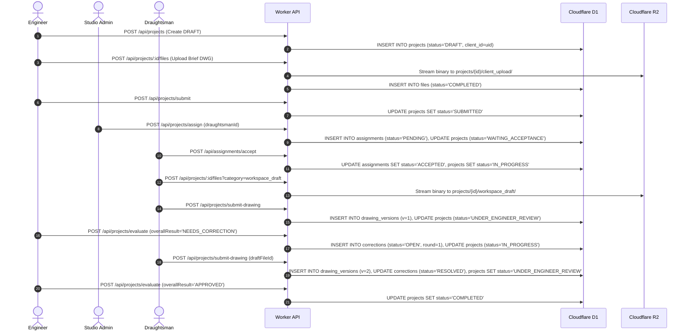

# ARCHI DRAFT — MASTER INTEGRATION & SYSTEM ARCHITECTURE GUIDE

**Repository Root:** `D:\PROJECT\Archidraft-integration-workspace`  
**Git Branch:** `COMPLETED-INTERGRATION` (Active delivery branch, created from verified base `integration/engineer-draughtsman` @ `8f753a97315c59c33eb1b0ad1578951434ae368e`)  
**Verified Base HEAD:** `8f753a97315c59c33eb1b0ad1578951434ae368e`  
**Delivery Branch Target:** `COMPLETED-INTERGRATION` (Creation, commits, and push held strictly pending explicit owner approval)  
**System Architecture:** Flutter Multiplatform Client (Web, Desktop, Android) + Cloudflare Worker API (Hono) + Cloudflare D1 (Relational SQLite) + Cloudflare R2 (Object Storage) + Firebase Auth (Cryptographic Identity Verification)

---

## 1. Project Overview

**ARCHI DRAFT** is an enterprise-grade architectural and technical drawing production platform connecting Engineers/Clients, Professional Draughtsmen, CAD Academy Students, and Studio Administrators in a secure, role-governed workflow.

### Architecture Highlights
- **Client Application:** Flutter (Dart 3.4+ / Flutter 3.22+) using Riverpod 2.x for reactive state management and GoRouter for declarative, role-guarded, fail-closed navigation.
- **Backend Edge API:** Cloudflare Worker running Hono with strict server-side middleware for Firebase token verification, DPDP-compliant Terms of Service gating, and row-level data access control.
- **Database Layer:** Cloudflare D1 (`archi-draft-db`), a globally distributed relational SQLite database storing users, projects, drawing versions, assignments, evaluations, notifications, and legal consent audits.
- **File Storage:** Cloudflare R2 (`archi-draft-storage`), housing CAD files (`.dwg`, `.dxf`), architectural briefs, revision markups, and digitally signed PDF training certificates.
- **Identity Provider:** Google Firebase Authentication providing cryptographically signed RS256 JWT tokens.

### Persona Panels
1. **Engineer Panel:** Allows architects and structural engineers to draft project briefs, specify drawing requirements (scale, area, delivery timeline), submit projects to the Studio pool, review submitted revisions, annotate drawings with structured corrections, and approve final drawings.
2. **Draughtsman Panel:** Enables professional CAD operators to view incoming studio assignments, accept or reject workloads, maintain private cloud workspace drafts, submit formal versions (`draughtsman_version`), review engineer markups, and resolve correction rounds.
3. **Student Panel:** Facilitates CAD Academy learning through curriculum modules, lesson completion tracking, practical project submissions, evaluator feedback review, verified credential generation, and public digital portfolio showcase.
4. **Admin Panel:** External administration workspace dedicated to operational management: project assignments, reassignments, draughtsman pool monitoring, student evaluations, digital credential issuance, platform legal policy publication, and DPDP/IT SPDI privacy request resolution.

---

## 2. Repository Map

```text
Archidraft-integration-workspace/
|-- lib/                                  # Flutter Client Application Source
|   |-- main.dart                         # Application entrypoint & Riverpod initialization
|   |-- src/
|   |   |-- core/                         # Core routing, theme, and network infrastructure
|   |   |   |-- router/app_router.dart    # GoRouter configuration, auth guards & fail-closed legal gating
|   |   |   |-- theme/                    # AppColors, AppTypography, AppSpacing design system
|   |   |   \-- network/                  # Base HTTP client with Bearer token injection
|   |   |-- features/
|   |   |   |-- auth/                     # Firebase Auth state, login & provisioning screens
|   |   |   |-- engineer/                 # Engineer portal screens (projects, briefs, reviews)
|   |   |   |-- draughtsman/              # Draughtsman portal screens (studio, workspace, drawings, insights)
|   |   |   |-- student/                  # Student portal reservation & documentation
|   |   |   |-- training/                 # Student curriculum, lesson viewers & progress tracking
|   |   |   |-- portfolio/                # Student showcase & verified project displays
|   |   |   |-- verification/             # Public certificate verification screen (/verify/:token)
|   |   |   |-- legal/                    # DPDP Act & IT SPDI legal onboarding, center & privacy tickets
|   |   |   |-- projects/                 # Shared project domain models, repositories & providers
|   |   |   |-- notifications/            # In-app notification center & real-time badge updates
|   |   |   |-- profile/                  # User profile models, forms & skill matrix cards
|   |   |   \-- shell/                    # Responsive application shells (AppShell, StudentShell)
|-- test/                                 # Flutter Automated Test Suites (320 tests)
|   |-- features/
|   |   |-- legal/                        # Domain model, onboarding widget, and router integration tests
|   |   |-- engineer/                     # Engineer workflow and UI tests
|   |   |-- draughtsman/                  # Draughtsman studio, workspace, and CAD viewer tests
|   |   \-- student/                      # Student training, lesson, and credential tests
|   \-- unit/                             # Form validators, domain serialization, voice note tests
|-- worker/                               # Cloudflare Worker Backend Source (199 tests)
|   |-- src/
|   |   |-- index.ts                      # Hono API router, business logic, file streaming & middleware
|   |   |-- auth.ts                       # Firebase JWKS token verification with test-runtime bypass
|   |   |-- legal.ts                      # DPDP legal routes, terms assertion gate & consent ledger
|   |   \-- achievements.ts               # Student badge calculation & milestone analytics
|   |-- migrations/                       # D1 SQLite relational migrations (0001 through 0017)
|   |   |-- 0001_schema.sql               # Users, projects, drawing_versions, activity_logs
|   |   |-- 0002_assignments.sql          # Draughtsman assignments
|   |   |-- 0003_files.sql                # R2 file metadata & lifecycle tracking
|   |   |-- 0004_corrections.sql          # Revision correction tracking
|   |   |-- 0005_notifications.sql        # Notification queue
|   |   |-- 0006_financials.sql           # Invoices and payments
|   |   |-- 0007_student_profile.sql      # Student profile fields (college_name)
|   |   |-- 0008_user_profile_fields.sql  # User profile table reconstruction (qualification, mobile, etc.)
|   |   |-- 0009_project_messages.sql     # In-project collaboration chat messages
|   |   |-- 0010_student_training.sql     # Training modules & student assignments
|   |   |-- 0011_student_lessons.sql      # Curriculum lessons & completion tracking
|   |   |-- 0012_evaluations.sql          # Rubric scoring & evaluation records
|   |   |-- 0013_student_credentials.sql  # Digital credentials
|   |   |-- 0014_student_credentials_artifact.sql # Certificate object key
|   |   |-- 0015_student_credentials_verification.sql # Public verification token index
|   |   |-- 0016_legal_system.sql         # Legal documents, consent events, privacy requests
|   |   \-- 0017_users_email_unique.sql   # Case-insensitive global unique email index
|   \-- test/                             # Node.js backend integration test harness
|       |-- backend_authorization.test.mjs# Core project mutation & role authorization tests (73 tests)
|       |-- cross_user_isolation_f1.test.mjs # Cross-user, cross-role & ID tampering isolation tests (95 tests)
|       |-- admin_student_contract.test.mjs  # Admin-to-Student training review contracts (13 tests)
|       \-- legal_privacy_authorization.test.mjs # Legal system, DPDP consent & public verify tests (18 tests)
\-- docs/                                 # Architectural specifications, contracts & handover reports
```

---

## 3. Engineer Panel Guide

- **Primary Route:** `#/engineer/projects` (Navigates to `EngineerProjectsScreen`)
- **Key Screens:**
  - `engineer_projects_screen.dart`: Tabbed project listings (`All`, `Drafts`, `In Progress`, `Under Review`, `Completed`).
  - `project_form_screen.dart`: Multi-step project creation wizard (`DRAFT` creation, requirement specification, brief upload).
  - `project_detail_screen.dart`: Detailed timeline, CAD drawing viewer, version comparison, and reviewer actions.
  - `engineer_activity_screen.dart`: Filtered audit log of events on owned projects.
- **State Providers (`lib/src/features/projects/providers/project_providers.dart`):**
  - `engineerProjectsProvider`: Streams projects where `client_id == uid`.
  - `projectDetailProvider(id)`: Fetches project metadata.
  - `projectDrawingVersionsProvider(id)`: Lists formal submitted versions.
  - `projectCorrectionsProvider(id)`: Retrieves active and historical correction rounds.
- **Workflow & Rules:**
  1. Creating a project via `POST /api/projects` stores it in `DRAFT` status.
  2. Engineer uploads reference sketches via `POST /api/projects/:id/files?category=client_upload`.
  3. Submitting via `POST /api/projects/submit` transitions status to `SUBMITTED`, queuing it for Admin assignment.
  4. Once a draughtsman submits work (`UNDER_ENGINEER_REVIEW`), Engineer evaluates via `POST /api/projects/evaluate`:
     - `APPROVED`: Completes project, notifies draughtsman.
     - `NEEDS_CORRECTION`: Increments `correction_round`, sets project back to `IN_PROGRESS`, records correction items.
     - `REJECTED`: Cancels project.

---

## 4. Draughtsman Panel Guide

- **Primary Route:** `#/draughtsman/studio` (Navigates to `DraughtsmanStudioScreen`)
- **Key Screens:**
  - `draughtsman_studio_screen.dart`: Overview of assigned tasks, active drawings, and pending assignments.
  - `draughtsman_assignment_detail_screen.dart`: Review project brief, scope, and accept/reject actions.
  - `draughtsman_workspace_screen.dart`: Working CAD canvas, upload working drafts, review engineer corrections.
  - `draughtsman_drawings_screen.dart`: Library of all past and present drawing deliveries.
  - `draughtsman_insights_screen.dart`: Performance analytics (average revision rounds, on-time delivery rate).
- **State Providers (`lib/src/features/projects/providers/assignment_providers.dart`):**
  - `draughtsmanAssignmentsProvider`: Queries `GET /api/assignments`, strictly filtered to the authenticated draughtsman.
- **Workflow & Rules:**
  1. Draughtsman reviews assignment in `WAITING_ACCEPTANCE`.
  2. Accepts via `POST /api/assignments/accept` (transitions project to `IN_PROGRESS`) or rejects via `POST /api/assignments/reject`.
  3. Draughtsman uploads working drafts via `POST /api/projects/:id/files?category=workspace_draft`.
  4. Draughtsman can delete their own drafts via `DELETE /api/projects/:id/files/:fileId`.
  5. Submitting formal delivery via `POST /api/projects/submit-drawing` creates a new entry in `drawing_versions` (`version_number` incremented) and sets project to `UNDER_ENGINEER_REVIEW`. Submitted versions cannot be deleted by non-admins.

---

## 5. Student Panel Guide

- **Primary Route:** `#/student/dashboard` (Navigates to `StudentStudioScreen` embedded in `StudentShell`)
- **Key Screens:**
  - `student_training_screen.dart`: Interactive curriculum browser with module cards and completion meters.
  - `training_module_detail_screen.dart` & `lesson_screen.dart`: Markdown lesson viewers and exercise instructions.
  - `student_projects_screen.dart` & `student_project_workspace_screen.dart`: Practical drafting projects assigned by Studio Admin.
  - `student_portfolio_screen.dart`: Showcase of completed, approved practical projects with rubric scores.
  - `student_credentials_card.dart`: Digital certificates with QR verification links.
- **Workflow & Rules:**
  1. Student completes theory lessons via `POST /api/student/training/lessons/:id/progress`.
  2. Studio Admin assigns a practical training project (`is_training_project = 1`).
  3. Student drafts drawing in CAD workspace and submits via `POST /api/projects/submit-drawing`.
  4. Admin reviews submission via `POST /api/projects/evaluate`.
  5. Upon approval (`APPROVED`), D1 atomically records completion, generates a cryptographic verification token, and allows certificate PDF generation (`POST /api/student/credentials/:id/certificate`).
  6. Certificate can be verified by any third party without authentication via `GET /api/public/credentials/verify/:token` or on the web at `#/verify/:token`.

---

## 6. Complete Workflow Map



---

## 7. Authentication & Account Isolation Architecture

### A. Single Shared Database vs. Physical Database Separation
The project uses a **single shared Cloudflare D1 relational database (`archi-draft-db`) and a single shared Cloudflare R2 bucket (`archi-draft-storage`)**.

It does **NOT** use separate physical database files per email. A separate physical database per email would break the platform's core operational requirements:
- Engineers assign projects to Draughtsmen in the same studio.
- Students submit drawings to Studio Administrators for rubric evaluation.
- Admins query aggregate metrics across projects, assignments, and draughtsmen.
- Foreign key integrity (`projects.client_id -> users.id`, `assignments.draughtsman_id -> users.id`) requires a unified relational catalog.

### B. Logical Tenant & Account Isolation Model
Account isolation is enforced **server-side at the Edge Worker layer through cryptographic identity verification and row-level ownership checks**:
1. **Cryptographic Identity Verification:** Every request must present a valid Firebase Bearer token. `auth.ts` verifies token signatures against Google's public JWKS. The authenticated UID (`c.get('uid')`) is derived exclusively from `payload.sub`. Client-supplied UIDs, headers, or body parameters are never trusted.
2. **Role & Provisioning Lockdown:** `POST /api/users` allows new users to self-provision only as `CLIENT`, `ENGINEER`, `DRAUGHTSMAN`, or `STUDENT`. `ADMIN` and `STUDIO_ADMIN` roles can never be self-assigned. Once created, user roles cannot be changed via client requests.
3. **Project Ownership Filtering:**
   - Engineers can only query and read projects where `client_id == uid`.
   - Draughtsmen can only query and read projects where `draughtsman_id == uid` and an accepted assignment exists.
   - Students can only access training projects (`is_training_project = 1`) assigned to them in `student_assignments`.
   - Admins can query all projects.
4. **Project Mutation Defense:** `POST /api/projects` verifies that if an existing project ID is supplied, `existing.client_id === uid` and `status === 'DRAFT'`. Any attempt by Account B to alter or overwrite Account A's project is rejected with `403 Forbidden`.
5. **R2 File Security:** Files in R2 cannot be accessed via direct public URLs. Downloads must route through `GET /api/files/:id/download`, where D1 ownership and assignment records are verified before streaming the object from R2.
6. **File Deletion Safeguards:** Only the uploader or an Admin can delete a file. Formal submitted drawing versions (`category = draughtsman_version`) cannot be deleted by non-admins.
7. **Legal Consent Privacy:** Terms acceptance, privacy acknowledgments, and DPDP grievance tickets are strictly keyed to `c.get('uid')`. No user can inspect or alter another user's consent records.
8. **Global Case-Insensitive Email Uniqueness:** User email addresses are globally unique across all roles (`CLIENT`, `ENGINEER`, `DRAUGHTSMAN`, `STUDENT`, `ADMIN`, `STUDIO_ADMIN`). The registration endpoint enforces a case-insensitive pre-check (`SELECT id FROM users WHERE LOWER(email) = LOWER(?)`) returning `409 Conflict` if duplicate. At the database layer, migration `0017_users_email_unique.sql` establishes `CREATE UNIQUE INDEX IF NOT EXISTS idx_users_email_lower ON users(LOWER(email));`.
9. **Pre-Login Terms & Conditions Onboarding:** The client application router enforces that all users must affirmatively review and accept mandatory Terms & Conditions immediately after role selection and before reaching the role-specific login screen (`Landing Page -> Role Selection -> Terms & Conditions -> Role Login -> Dashboard`). Declining returns to role selection; logout resets transient acceptance.

---

## 8. API Integration Guide

All endpoints require `Authorization: Bearer <Firebase_ID_Token>` unless marked `[PUBLIC]`.

| Method | Endpoint | Allowed Roles | Description | Response Status |
| :--- | :--- | :--- | :--- | :--- |
| `POST` | `/api/users` | Any Authenticated | Self-service profile creation/update (Role cannot be escalated; global case-insensitive email uniqueness enforced). | `200 OK`, `400, 403, 409` |
| `GET` | `/api/users/profile` | Any Authenticated | Retrieves current user's profile from D1. | `200 OK`, `404` |
| `GET` | `/api/projects` | Any Authenticated | Lists projects owned by or assigned to caller (Admins receive all). | `200 OK` |
| `POST` | `/api/projects` | `ENGINEER` | Creates or updates a DRAFT project (Ownership verified). | `200 OK`, `403` |
| `POST` | `/api/projects/submit` | `ENGINEER` | Submits draft project (`DRAFT` -> `SUBMITTED`). | `200 OK`, `403` |
| `GET` | `/api/projects/:id` | Owning Eng / Assigned Drg / Admin | Retrieves project detail and status. | `200 OK`, `403, 404` |
| `POST` | `/api/projects/:id/files` | Permitted Project Roles | Streams file to R2 (`client_upload`, `workspace_draft`). | `200 OK`, `403` |
| `GET` | `/api/files/:id/download` | Permitted Project Roles | Streams file from R2 after authorization check. | `200 OK`, `403, 404` |
| `DELETE`| `/api/projects/:id/files/:fileId` | Uploader / Admin | Deletes unpromoted working file from D1 and R2. | `200 OK`, `403, 404` |
| `GET` | `/api/assignments` | `DRAUGHTSMAN`, `ADMIN` | Lists assignments for draughtsman (or all for admin). | `200 OK`, `403` |
| `POST` | `/api/assignments/accept` | Assigned `DRAUGHTSMAN` | Accepts incoming assignment (`WAITING_ACCEPTANCE` -> `IN_PROGRESS`). | `200 OK`, `400, 403` |
| `POST` | `/api/assignments/reject` | Assigned `DRAUGHTSMAN` | Rejects incoming assignment with reason. | `200 OK`, `400, 403` |
| `POST` | `/api/projects/submit-drawing` | Assigned Drg / Student | Submits drawing version (`IN_PROGRESS` -> `UNDER_ENGINEER_REVIEW`). | `200 OK`, `400, 403` |
| `POST` | `/api/projects/evaluate` | Reviewing Eng / Admin | Evaluates submission (`APPROVED`, `NEEDS_CORRECTION`, `REJECTED`). | `200 OK`, `400, 403` |
| `GET` | `/api/projects/:id/messages` | Project Participants / Admin | Retrieves in-project collaboration chat messages. | `200 OK`, `403` |
| `POST` | `/api/projects/:id/messages` | Project Participants / Admin | Sends message with optional audio/document attachment. | `201 Created`, `403` |
| `GET` | `/api/student/training/modules` | `STUDENT` | Retrieves curriculum modules and completion progress. | `200 OK`, `403` |
| `POST` | `/api/student/training/lessons/:id/progress` | `STUDENT` | Marks theory lesson `IN_PROGRESS` or `COMPLETED`. | `200 OK`, `403` |
| `GET` | `/api/student/portfolio` | `STUDENT` | Aggregates approved practical projects and rubric scores. | `200 OK`, `403` |
| `GET` | `/api/public/credentials/verify/:token` | **[PUBLIC]** | Validates certificate authenticity (Neutral recipient privacy). | `200 OK`, `404` |
| `GET` | `/api/legal/documents/effective/:type` | **[PUBLIC]** | Retrieves currently effective Terms or Privacy Policy. | `200 OK`, `404` |
| `POST` | `/api/legal/accept-terms` | Any Authenticated | Records affirmative Terms of Service acceptance in D1 ledger. | `200 OK`, `400` |
| `POST` | `/api/users/me/privacy-requests` | Any Authenticated | Submits DPDP / IT SPDI grievance or data rights ticket. | `200 OK`, `400` |

---

## 9. Admin Integration Readiness Guide

The external Admin UI belongs to another developer and connects directly to the Worker backend. Below is the verified readiness matrix:

| Admin Capability | Endpoint & Method | Backend Status | Integration Readiness Verdict | Notes |
| :--- | :--- | :--- | :--- | :--- |
| **Platform Dashboard KPIs** | `GET /api/admin/dashboard` | **IMPLEMENTED & VERIFIED** | **READY TO WIRE** | Returns totalProjects, activeProjects, pendingAssignments, activeDraughtsmen, etc. |
| **All Projects Listing** | `GET /api/projects?status=` | **IMPLEMENTED & VERIFIED** | **READY TO WIRE** | Returns full project records across all owners when caller is `ADMIN`. |
| **Assign Commercial Project** | `POST /api/projects/assign` | **IMPLEMENTED & VERIFIED** | **READY TO WIRE** | Assigns project in `WAITING_ASSIGNMENT` to draughtsman. |
| **Reassign Active Project** | `POST /api/projects/reassign` | **IMPLEMENTED & VERIFIED** | **READY TO WIRE** | Reassigns project in `IN_PROGRESS` or `WAITING_ACCEPTANCE`. |
| **List Available Draughtsmen**| `GET /api/users?role=DRAUGHTSMAN` | **IMPLEMENTED & VERIFIED** | **READY TO WIRE** | Returns draughtsman directory for assignment dropdowns. |
| **Student Submissions Review** | `GET /api/admin/student-submissions` | **IMPLEMENTED & VERIFIED** | **READY TO WIRE** | Lists training submissions with student names, module titles, and drawing versions. |
| **Student Profile Inspection** | `GET /api/admin/students/:studentId` | **IMPLEMENTED & VERIFIED** | **READY TO WIRE** | Returns safe profile, training history, and earned credentials. |
| **Evaluate Student Submissions**| `POST /api/projects/evaluate` | **IMPLEMENTED & VERIFIED** | **READY TO WIRE** | Accepts rubric scoring, issues credentials upon approval. |
| **Legal Policy Publication** | `POST /api/admin/legal/documents` & `/publish` | **IMPLEMENTED & VERIFIED** | **READY TO WIRE** | Atomic promotion to `EFFECTIVE` status, triggers reacceptance. |
| **DPDP Privacy Redressal** | `GET /api/admin/legal/privacy-requests` & `/:id/resolve` | **IMPLEMENTED & VERIFIED** | **READY TO WIRE** | Manages statutory data access, correction, and grievance tickets. |
| **Consent Audit Trail** | `GET /api/admin/legal/consents` | **IMPLEMENTED & VERIFIED** | **READY TO WIRE** | Paginated audit log of consent actions across the user base. |
| **Project Financials Setup** | `PATCH /api/projects/:id/financials/total_value` | **IMPLEMENTED & VERIFIED** | **READY TO WIRE** | Updates total agreed project contract amount. |
| **Invoice & Payment Issuance** | `POST /api/projects/:id/invoices` & `/payments` | **IMPLEMENTED & VERIFIED** | **READY TO WIRE** | Generates billing milestones and logs disbursements. |
| **Server-Side Project Deletion**| `DELETE /api/projects/:id` | **MISSING BACKEND SUPPORT** | **REQUIRES OWNER DECISION** | Full project cascade deletion currently omitted to prevent accidental loss; use status `CANCELLED`. |
| **Server-Side Pagination** | `GET /api/projects?limit=&offset=` | **AVAILABLE VIA BACKEND, NOT YET PAGINATED** | **CONTRACT COMPATIBLE** | Returns unpaginated array currently; add pagination when project volume exceeds 500. |

---

## 10. Local Setup & Verification

### Prerequisites
- Flutter SDK `>= 3.22.0` (Dart `>= 3.4.0`)
- Node.js `>= 18.18.0` (v20+ recommended)
- Cloudflare Wrangler (bundled in `worker/node_modules`)

### Step 1: Install Dependencies
```bash
# In repository root
flutter pub get

# In worker directory
cd worker
npm install
cd ..
```

### Step 2: Run Verification Test Suites
```bash
# 1. Run complete Worker test harness (217 tests: authorization, isolation, admin contracts, legal, financials, notifications)
cd worker
npm test
cd ..

# 2. Run Worker TypeScript type check (must report 0 errors)
cd worker
npm run typecheck
cd ..

# 3. Run complete Flutter test suite (320 tests)
flutter test

# 4. Run Flutter static analysis (must report no issues)
flutter analyze
```

---

## 11. Known Limitations & Remaining Work

### Confirmed Implemented & Verified
- Complete Engineer-Draughtsman collaboration lifecycle (DRAFT -> SUBMITTED -> ASSIGNED -> IN_PROGRESS -> UNDER_REVIEW -> CORRECTION -> COMPLETED).
- Multi-user data isolation across Engineers, Draughtsmen, Students, and Administrators.
- Server-side ID tampering defense on project creation and drawing promotion.
- Fail-closed legal policy routing and DPDP Act / IT SPDI consent framework.
- Student CAD Academy curriculum, practical submissions, and credential generation.
- Public certificate verification with recipient privacy protection.

### Architectural Decisions Requiring Project Owner Approval
1. **Permanent Project Deletion Endpoint:** Currently, projects can be cancelled (`status = CANCELLED`), but physical deletion of projects via API is intentionally omitted to protect drawing history and financial audit trails.
2. **Server-Side Pagination on Project Feeds:** `/api/projects` currently returns full lists. If project volume grows beyond 500 active records per firm, pagination (`limit`/`offset`) should be added in a backward-compatible manner.
3. **Legal Document Content Review:** The seeded legal documents (Terms and Privacy Policy) are comprehensive legal scaffolds compliant with the DPDP Act 2023. Formal legal counsel review is recommended before public platform commercialization.

---

## 12. Instructions for the Next Developer's Antigravity Session

Welcome to the ARCHI DRAFT codebase! Follow these strict rules to ensure seamless integration:

1. **Read This Document First:** Review this `README.md`, `HANDOVER_SETUP_GUIDE.md`, and `docs/FINAL_VERIFICATION_AND_HANDOVER_REPORT.md` before making code modifications.
2. **Inspect Current Git State:** Run `git status --short` and `git rev-parse HEAD`. Verify that you are working on `COMPLETED-INTERGRATION` (base HEAD `8f753a97315c59c33eb1b0ad1578951434ae368e`) with the approved 152-file staged integration snapshot for owner review.
3. **Preserve Existing Architecture:** Do not attempt to migrate the database to a separate physical SQLite database per email; the shared D1 model with row-level ownership is verified, tested, and required for cross-role collaboration.
4. **Preserve the External Admin UI:** Do not rewrite or modify the external Admin panel. Use the Admin Integration Readiness Matrix in Section 9 to wire the Admin UI to existing Worker endpoints.
5. **Reuse Tested Endpoints:** All mutation and query routes in Section 8 are backed by 217 automated integration tests. Always reuse these contracts instead of inventing new ad-hoc routes.
6. **Report Before Expanding Scope:** If you believe an endpoint is missing or a business decision is required, document the proposed contract and seek project owner confirmation before building it.
7. **Run Tests After Any Edit:** Before declaring any task finished, run `npm test` and `npm run typecheck` in `worker/`, and `flutter test` and `flutter analyze` at the root. All tests must pass with zero errors.
8. **Never Touch Production or Protected Accounts:** Never run remote D1/R2 commands, never touch production Firebase Auth, and never modify or sign in as protected test accounts (`zedsuo125@gmail.com`, `mohdanas53@gmail.com`, `ashrafbari277@gmail.com`, `mdjanis2006@gmail.com`, `pixelmintstudio01@gmail.com`). Leave all changes uncommitted for project owner review.
9. **Branch Policy & Delivery Governance (Strict Owner Approval Gate):**
   - **Active Delivery Branch:** `COMPLETED-INTERGRATION` already exists and is the current active branch (created from verified base HEAD `8f753a97315c59c33eb1b0ad1578951434ae368e`).
   - **Staged Integration Snapshot:** The current approved 152-file integration snapshot is staged in the Git index for project owner review.
   - **No Commit or Push Authorized Yet:** No commit or push has been authorized yet. A separate, explicit project owner approval is strictly required before creating any commit or pushing to remote origin.
   - **Strict Prohibition on `develop` and `main`:** This multi-portal integration must NOT be merged or pushed into `develop` or `main`.
   - **Deployment Prohibited:** Deployments to production Cloudflare Workers, D1 database, or R2 storage remain strictly prohibited without separate explicit project owner authorization.

---

> **Deployment Note:**
> - Migrations `0001` through `0007` have been applied to remote production D1.
> - Migrations `0008` through `0017` and Worker deployment are **pending** and have not been executed on production.

