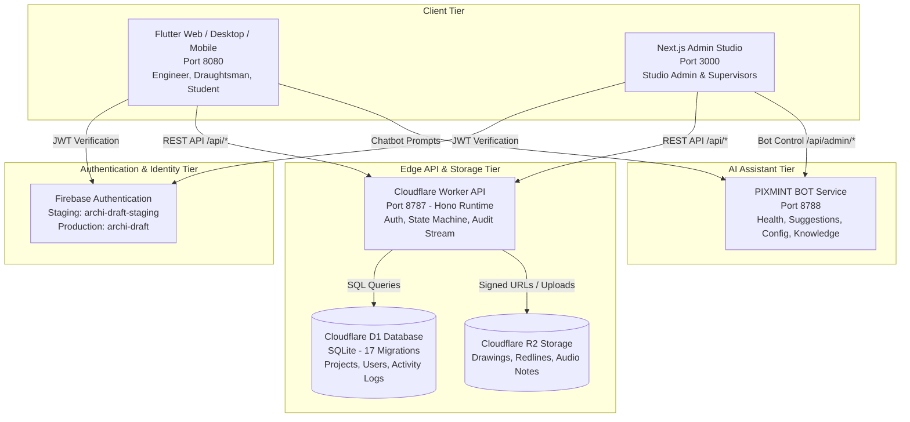

# SYSTEM ARCHITECTURE & INTEGRATION SPECIFICATION

**Repository Branch:** `COMPLETED-INTERGRATION` (HEAD: `f21fb29`)
**Workspace:** `D:\PROJECT\Archidraft-integration-workspace`
**Ecosystem:** Flutter Multi-Persona Client + Next.js Admin Studio + Cloudflare Worker API + Cloudflare D1 & R2 + Firebase Auth + PIXMINT BOT 2.0 Integration

---

## 1. Architectural Overview & System Tiers

The Archi Draft Studio platform implements a distributed, role-isolated architecture combining multiplatform frontends, edge serverless computing, relational database storage, secure object storage, and an integrated AI assistant.



---

## 2. Multiplatform Client Tier

### A. Flutter Multi-Persona Application (`lib/`)
- **Port:** `8080`
- **Target Personas:**
  1. **Engineer (Client):** Project brief creation, scope specification, reference uploads, drawing review, redline markup, correction requests, and final drawing approval.
  2. **Draughtsman:** Assignment acceptance/rejection, drawing drafts, CAD/DXF/DWG revision submissions, and collaboration communication.
  3. **Student:** Modular CAD training curriculum, lesson completion, practical project submission, and instructor rubric review.
- **Pre-Login Legal Gate:** Pre-login onboarding gate enforcing Terms & Conditions acceptance prior to credential entry.
- **Firebase Project Selection:** Governed at compile time by `lib/firebase_options.dart` via `--dart-define=STAGING=true`.
- **API Base URL Resolution:** Governed by `lib/src/features/api/data/api_client.dart` via `--dart-define=API_URL=...` (defaults safely to `http://localhost:8787` in debug/test mode).

### B. Next.js Studio Admin Web Portal (`apps/admin-web/`)
- **Port:** `3000`
- **Target Persona:** Studio Administrator
- **Key Capabilities:**
  - Executive Dashboard metrics and project status breakdown.
  - Engineer, Draughtsman, and Student Directories with quick-view modal previews and comprehensive dossiers.
  - Project review, capacity assessment, and draughtsman assignment dispatch.
  - Student practical submission evaluation queues and rubric scoring.
  - Live Activity Feed (`/activity`) with automatic 15-second polling and real-time system audit logs.
  - PIXMINT BOT Control Center (`/settings/pixmint-bot`).

---

## 3. PIXMINT BOT 2.0 Integration & Service Boundaries

The PIXMINT AI Assistant is integrated across both frontend portals:
1. **Flutter Client Integration (`scratch/pixmint-bot/`):**
   - Embedded chatbot drawer with animated mascot and floating trigger.
   - Text input component (`pixmint_chat_input.dart`) styled with dark text against a white rounded input container, visible black cursor, and focus border.
2. **Admin Control Center (`apps/admin-web/src/components/admin/PixmintBotControlCenter.tsx`):**
   - Renders official brand logo (`/images/pixmint-bot-logo.jpeg`).
   - Interacts with PIXMINT service at `http://127.0.0.1:8788` (`NEXT_PUBLIC_PIXMINT_API_URL`).
   - Manages bot telemetry, suggested prompt templates, bot maintenance toggles, knowledge source status, user feedback, and unanswered queries.

> [!IMPORTANT]
> **Strict Architectural Boundaries:**
> - PIXMINT does **NOT** handle Firebase authentication or user identity verification.
> - PIXMINT does **NOT** transition project state machine stages or bypass backend authorization rules.

---

## 4. Backend Worker API Tier (`worker/`)

Built with the Hono serverless framework running on Cloudflare Workers edge runtime:
- **Port:** `8787`
- **Authentication:** Verifies incoming `Authorization: Bearer <token>` against Firebase public JWKS certificates, resolving `uid` and role claims.
- **Tenant & Role Authorization:** Strict role-based access control (`STUDIO_ADMIN`, `ADMIN`, `ENGINEER` / `CLIENT`, `DRAUGHTSMAN`, `STUDENT`).
- **State Machine Transitions:** Enforces sequential project lifecycle states:
  `DRAFT` ➔ `SUBMITTED` ➔ `WAITING_ASSIGNMENT` ➔ `WAITING_ACCEPTANCE` ➔ `IN_PROGRESS` ➔ `IN_REVIEW` ➔ `CORRECTION_REQUESTED` ➔ `COMPLETED` (or `CANCELLED`).
- **File Transfer Security:** Mediates all file uploads/downloads to Cloudflare R2 using pre-signed URLs or stream handlers with ownership verification.

---

## 5. Activity Logging Architecture (`activity_logs`)

The platform implements an automated audit logging pipeline to ensure full traceability across all workflow operations.

### Data Flow & Endpoint
1. **Data Model:** Stored in the `activity_logs` table:
   ```sql
   CREATE TABLE activity_logs (
     id TEXT PRIMARY KEY,
     project_id TEXT,
     actor_id TEXT NOT NULL,
     actor_role TEXT NOT NULL,
     action_type TEXT NOT NULL,
     details TEXT,
     timestamp TEXT NOT NULL
   );
   ```
2. **Endpoint:** `GET /api/activity?limit=100`
   - Query validation: `limit` parameter clamped between 1 and 500 (default 100).
   - SQL Query: Uses `LEFT JOIN projects p ON a.project_id = p.id` to ensure system/user events without an associated project ID are never dropped.
   - Ordering: Reverse chronological order (`ORDER BY a.timestamp DESC LIMIT ?`).
3. **Role Authorization Matrix for `/api/activity`:**
   - `ADMIN` & `STUDIO_ADMIN`: Full global platform audit stream.
   - `ENGINEER` & `CLIENT`: Scoped to projects owned by the user (excluding internal reassignments).
   - `DRAUGHTSMAN`: Scoped to projects assigned to the draughtsman.
   - `STUDENT` / Unauthenticated / Guests: Rejected (`403 Forbidden` / `401 Unauthorized`).
4. **Admin UI Resiliency (`apps/admin-web/src/app/activity/page.tsx`):**
   - Background polling every 15 seconds.
   - If a background poll encounters network failure, previously retrieved events are retained and displayed alongside an ambient retry banner.
   - Distinguishes between authentication errors (401/403), server outages (500), and a truthful empty state (0 records found in D1).

---

## 6. User Directory & Dossier Data Architecture

The Admin Studio provides hierarchical inspection of platform users:

### Directory ➔ Modal ➔ Dossier Navigation
1. **Directory View (`/engineers`, `/draughtsmen`, `/students`):**
   - Displays user lists with search, status filters, and action buttons.
2. **Quick-View Modal (`apps/admin-web/src/components/ui/Modal.tsx`):**
   - Upgraded to support responsive `maxWidth="2xl"` with explicit `max-h-[92vh]` vertical scroll containment.
   - Prevents role badge clipping and content overflow.
3. **Full Dossier View (`/engineers/[id]`, `/draughtsmen/[id]`, `/students/[id]`):**
   - URL parameter decoding handles canonical identifiers reliably.
   - Normalization Layer (`adminApi.getUserDetails` in `apps/admin-web/src/lib/api.ts`):
     - Gracefully processes both nested payloads (`{ user, projects }`) and flat payloads (`{ id, email, role, ... }`).
     - Performs fallback lookups via `getUsers()` if direct endpoint lookup is unpopulated.
     - Role-specific project lookups:
       - Engineers: Matches `projects.filter(p => p.client_id === userId)`.
       - Draughtsmen: Fetches assignments via `getAdminAssignments({ draughtsmanId: userId })`, falling back to project filter.
       - Students: Fetches training assignments from `/api/admin/students/[id]`.
   - Error Handling: Renders dedicated error cards for 401/403 authorization failures, 404 missing profiles, and connection drops.
