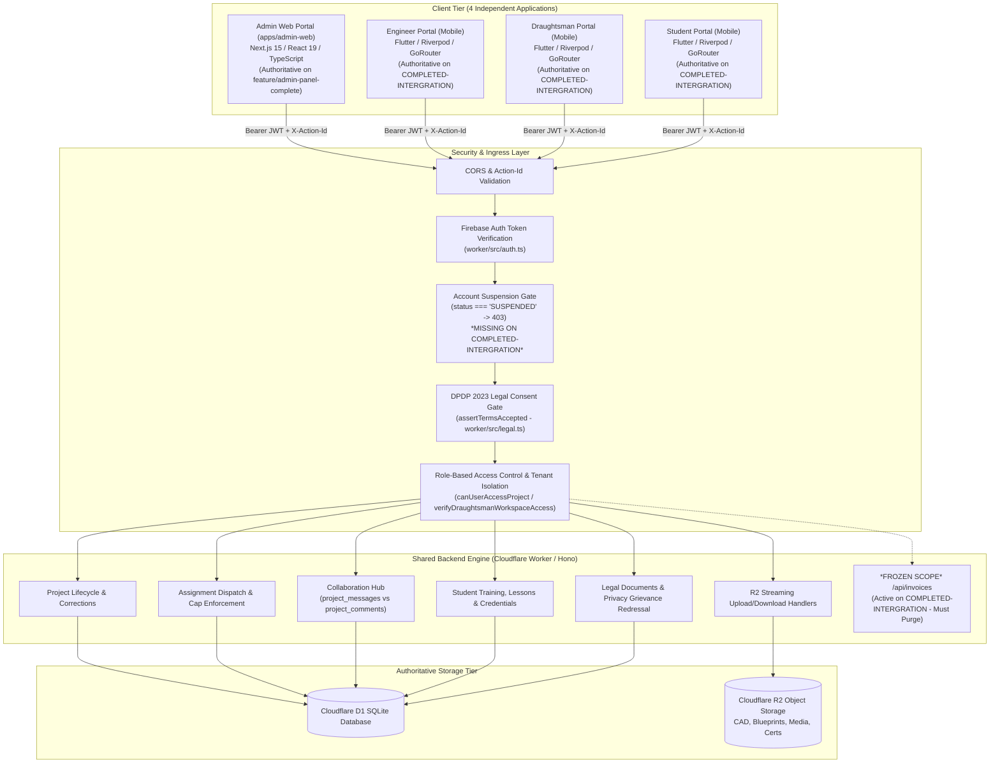
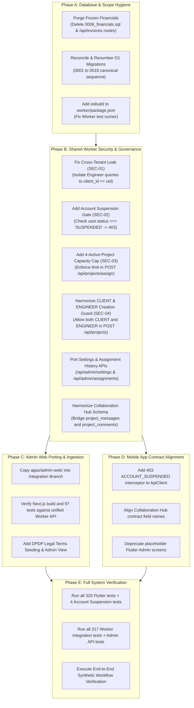

# ARCHIDRAFT — CANONICAL INTEGRATION BRANCH AUDIT REPORT
**Target Branch:** `COMPLETED-INTERGRATION`  
**Repository:** `https://github.com/pixelmint-studio-mvs/Archidraft.git`  
**Audit Date:** October 23, 2026  
**Auditor:** Antigravity Senior Full-Stack, Security, & Integration QA Lead  
**Audit Type:** Strictly Read-Only Architecture, Security, RBAC & Contract Compatibility Audit  
**Overall Verdict:** **NO-GO FOR IMMEDIATE DEPLOYMENT / CONDITIONAL GO FOR REMEDIATION**

---

## 1. Executive Summary and Overall Verdict

### 1.1 Executive Summary
A comprehensive, evidence-based, strictly read-only audit of the canonical integration branch `COMPLETED-INTERGRATION` (`commit cd5866e1`) was performed in an isolated git worktree, cross-referencing the authoritative Admin Portal implementation on `feature/admin-panel-complete` (`commit 8ea5d4c5`).

The branch `COMPLETED-INTERGRATION` represents significant engineering progress across the **Engineer**, **Draughtsman**, and **Student** mobile applications within the Flutter codebase, accompanied by extensive test coverage (**320/320 Flutter tests passing**, **0 analyzer issues**). It introduces a fail-closed legal system under the India Digital Personal Data Protection (DPDP) Act 2023, practical student curriculum training, instructor evaluations, and public QR credential verification.

However, the branch is **NOT integration-ready** for production deployment or unguided merge. It contains four critical architectural blockers and one high-severity cross-tenant security vulnerability:

1. **Total Absence of Admin Web Portal (P0):** The modern, 13-panel Stitch-aligned Next.js 15 Admin Web portal (`apps/admin-web/`) does not exist on `COMPLETED-INTERGRATION`. The branch only contains legacy, incomplete Flutter mobile admin screens with placeholder widgets.
2. **D1 Migration Collisions (P0):** Migrations `0005`, `0006`, `0007`, and `0008` have directly conflicting sequence numbers and schemas across branches. Applying migrations in their current state would corrupt the D1 database.
3. **Strict Scope Mandate Violation (P0):** `COMPLETED-INTERGRATION` includes `0006_financials.sql` (invoices, payments) and active billing endpoints in `worker/src/index.ts`, directly violating the strict project mandate freezing `/financials` and payment functionality.
4. **Cross-Tenant Data Exposure Vulnerability (P0 - Security):** In `worker/src/index.ts` (lines 612 and 555), authenticated users with role `ENGINEER` are permitted to query and view projects owned by ANY user with role `CLIENT`, exposing blueprints, CAD files, and client metadata across tenant boundaries.
5. **Missing Governance & Safety Controls in Integration Worker (P0):** The Worker on `COMPLETED-INTERGRATION` lacks account suspension checking/routes, lacks dynamic upload ceiling enforcement, and lacks the 4-active-project Draughtsman assignment limit guard.
6. **Collaboration Hub Contract Duality (P1):** Integration branch mobile apps use `project_messages` (`/api/projects/:projectId/messages`), while the Admin Web portal and mobile repository on the Admin branch use `project_comments` (`/api/projects/:projectId/comments`).

### 1.2 Verdict
| Verdict | Status | Justification |
| :--- | :--- | :--- |
| **NO-GO** | **CONFIRMED** | Immediate production release or direct merge of `COMPLETED-INTERGRATION` into `main` or `feature/admin-panel-complete` is strictly prohibited. Doing so would lose the entire Admin Web Portal, break D1 migrations, expose private client drawings across engineer accounts, and violate the frozen financials boundary. |
| **CONDITIONAL GO** | **APPROVED FOR REMEDIATION** | The three mobile portals (Engineer, Draughtsman, Student) are structurally sound and verified. Integration can proceed safely following the phased, dependency-ordered remediation plan in Section 13. |

---

## 2. Environment, Branches, and Working-Tree State

### 2.1 Git Audit Environment
To protect existing work and prevent branch collision or working-tree resets, an isolated git worktree was created for the audit:

| Property | Active Workspace | Isolated Audit Worktree |
| :--- | :--- | :--- |
| **Directory Path** | `c:\Users\inaam\.gemini\antigravity-ide\scratch\Archidraft` | `c:\Users\inaam\.gemini\antigravity-ide\scratch\Archidraft\scratch\completed-integration` |
| **Active Branch** | `feature/admin-panel-complete` | `origin/COMPLETED-INTERGRATION` (detached HEAD) |
| **Commit SHA** | `8ea5d4c5c249caab923296c003fbdf7794017f8b` | `cd5866e18d1802c1c115ea3ba9fa4d6d57aab59d` |
| **Commit Date** | Oct 22, 2026 | Oct 22, 2026 19:36:53 +05:30 |
| **Working Tree Status** | Preserved (Admin Web polish & acceptance files intact) | Clean (Read-only inspection) |
| **Merge Base (Common Ancestor)** | `70aa55657242331091323ac18f5b0b3e2180773d` (`feat: complete Draughtsman workflow (Sections 5A-5G)`) |
| **Divergence** | +7 commits (+ working tree changes) | +29 commits |

---

## 3. Repository and Application Inventory

The target architecture specifies **four separate client applications sharing one authoritative Cloudflare Worker and D1/R2 backend**. Here is the verified inventory on `COMPLETED-INTERGRATION`:

```
Archidraft Repository (COMPLETED-INTERGRATION)
├── apps/                         [MISSING ON COMPLETED-INTERGRATION]
│   └── admin-web/                [ABSENT - Present only on feature/admin-panel-complete]
├── lib/                          [PRESENT - Flutter Multiplatform Application]
│   └── src/features/
│       ├── engineer/             [PRESENT - Production Engineer mobile portal]
│       ├── draughtsman/          [PRESENT - Production Draughtsman mobile portal]
│       ├── student/              [PRESENT - Student training & workspace portal]
│       ├── training/             [PRESENT - Student lessons, progress, evaluations]
│       ├── verification/         [PRESENT - Public QR credential verification]
│       ├── legal/                [PRESENT - DPDP Act 2023 terms onboarding & grievance]
│       ├── portfolio/            [PRESENT - Student portfolio & showcase]
│       ├── notifications/        [PRESENT - In-app notification center]
│       └── projects/
│           └── presentation/admin/ [LEGACY ONLY - Incomplete Flutter mobile admin screens]
├── worker/                       [PRESENT - Cloudflare Worker / Hono API]
│   ├── src/index.ts              [PRESENT - 3,204 lines of Hono API routes]
│   ├── src/legal.ts              [PRESENT - 770 lines of DPDP legal gate & handlers]
│   ├── src/achievements.ts       [PRESENT - Student achievement criteria engine]
│   ├── src/auth.ts               [PRESENT - Firebase token validator & test bypass]
│   ├── migrations/               [PRESENT - Migrations 0001 through 0016]
│   └── test/                     [PRESENT - 4 Node.js integration test suites (217 tests)]
```

### 3.1 Portal Implementation Status Matrix

| Application | Directory / Framework | Entry Point | Status on `COMPLETED-INTERGRATION` | Status on `feature/admin-panel-complete` | Verdict |
| :--- | :--- | :--- | :--- | :--- | :--- |
| **Admin Web Portal** | `apps/admin-web`<br>Next.js 15, React 19, Tailwind | `apps/admin-web/src/app/page.tsx` | **DOES NOT EXIST** (`apps/` directory is absent) | **100% COMPLETE & PASSING** (13 Stitch panels, 22 routes, 97 tests, zero type errors) | **BLOCKER (P0)**: Admin Web was never ported to integration branch |
| **Admin Flutter Mobile** | `lib/.../presentation/admin`<br>Flutter 3.13 / Dart 3 | `lib/src/features/shell/presentation/admin_shell.dart` | **INCOMPLETE**: Contains `PlaceholderScreen` for `/admin/users` and `/admin/system` | **DEPRECATED**: Replaced by dedicated Next.js Admin Web Portal | **CLEANUP (P3)**: Deprecate placeholder screens |
| **Engineer Mobile Portal** | `lib/src/features/engineer`<br>Flutter 3.13 / Riverpod | `lib/src/features/shell/presentation/engineer_shell.dart` | **COMPLETE**: Project brief creation, drawing attachments, live status, drawing preview | **PRESENT**: Functional, aligned with shared contracts | **READY**: 0 analyzer errors |
| **Draughtsman Mobile Portal**| `lib/src/features/draughtsman`<br>Flutter 3.13 / Riverpod | `lib/src/features/shell/presentation/draughtsman_shell.dart` | **COMPLETE**: Assignment acceptance/rejection, drawing version upload, correction workflow | **PRESENT**: Functional | **READY**: 0 analyzer errors |
| **Student Mobile Portal** | `lib/src/features/student`<br>Flutter 3.13 / Riverpod | `lib/src/features/shell/presentation/student_shell.dart` | **COMPLETE**: 6 training modules, practical assignments, rubric evaluations, credential certificates | **NOT INTEGRATED**: Absent on admin branch | **READY ON INTEGRATION**: Complete training subsystem |
| **Shared Backend API** | `worker/`<br>Cloudflare Workers / Hono | `worker/src/index.ts` | **DIVERGED**: 3,204 lines; contains training, DPDP legal, financials; lacks suspension/settings | **DIVERGED**: 1,645 lines; contains suspension, settings, 4-project cap, project comments | **BLOCKER (P0)**: Needs reconciliation |
| **D1 Database Schemas** | `worker/migrations/` | `0001_schema.sql` .. `0016_legal_system.sql` | **16 MIGRATIONS**: Contains financial tables; numbering collisions on 0005-0008 | **8 MIGRATIONS**: Contains `user_status`, `studio_settings`, `project_comments` | **BLOCKER (P0)**: Collisions require renumbering |
| **R2 Object Storage** | Cloudflare R2 | Worker streaming handlers | **COMPLETE**: Streaming byte counters, MIME whitelist, extension sanitization | **COMPLETE**: Matches R2 access patterns | **READY** |

---

## 4. Architecture Diagram and Data-Flow Map



---

## 5. Shared API Endpoint and Authorization Matrix

This matrix evaluates all endpoints implemented in `worker/src/index.ts` and `worker/src/legal.ts` on `COMPLETED-INTERGRATION`, compared against caller expectations across all four portals:

| HTTP Method & Route | Required Role | Ownership / Assignment Constraint | Request Schema | Response Code | Admin Web Caller | Engineer Mobile | Draughtsman Mobile | Student Mobile | Compatibility & Security Status |
| :--- | :--- | :--- | :--- | :--- | :--- | :--- | :--- | :--- | :--- |
| `POST /api/users` | Any authenticated | Self-service provisioning | `{ email, name, role, mobile, ... }` | `200 { success: true }`, `400/403` | Not used (Admin logs in) | Used on signup | Used on signup | Used on signup | **OK**: Enforces role whitelist |
| `GET /api/users/profile` | Any authenticated | Returns caller's profile | None | `200 User`, `404` | Used (`/api/users/me`) | Used | Used | Used | **MINOR MISMATCH**: Route alias exists |
| `GET /api/users/me` | Any authenticated | Returns caller's profile | None | `200 User`, `404` | Primary auth probe | Used | Used | Used | **OK** |
| `PATCH /api/users/me` | Any authenticated | Modifies caller's mutable fields | `{ name, mobile, address, ... }` | `200 { success: true }` | Used | Used | Used | Used | **OK**: Disallows updating `role` |
| `GET /api/users` | `ADMIN`, `STUDIO_ADMIN` | Enforces admin role check | Query: `?role=` | `200 User[]`, `403` | Primary directory hook | Blocked (403) | Blocked (403) | Blocked (403) | **OK**: Strictly protected |
| `PATCH /api/users/:id/status` | `ADMIN`, `STUDIO_ADMIN` | Account suspension toggle | `{ status: 'ACTIVE' \| 'SUSPENDED' }` | `200 User`, `403` | Used on all user panels | Blocked | Blocked | Blocked | **MISSING ON COMPLETED-INTERGRATION (P0)** |
| `GET /api/admin/settings` | `ADMIN`, `STUDIO_ADMIN` | Persisted studio settings | None | `200 StudioSettings` | Settings Panel hook | Blocked | Blocked | Blocked | **MISSING ON COMPLETED-INTERGRATION (P0)** |
| `PUT /api/admin/settings` | `ADMIN`, `STUDIO_ADMIN` | Modifies studio settings | `{ turnaroundDays, maxUploadCeiling, ... }` | `200 StudioSettings` | Settings Save hook | Blocked | Blocked | Blocked | **MISSING ON COMPLETED-INTERGRATION (P0)** |
| `GET /api/projects` | Any authenticated | Role-filtered: Client/Eng (own), Draughtsman (assigned), Student (training), Admin (all) | Query: `?status=` | `200 Project[]` | Used on Projects Panel | Used on Dashboard | Used on Workspace | Used on Practical Tab | **VULNERABLE (P0)**: Line 612 leaks `CLIENT` projects to any `ENGINEER` |
| `GET /api/projects/:id` | Any authenticated | Checked by `canUserAccessProject` | None | `200 Project`, `403`, `404` | Used on Project Detail | Used on Detail | Used on Workspace | Used on Assignment | **VULNERABLE (P0)**: Line 555 grants access to legacy `CLIENT` projects |
| `POST /api/projects` | `ENGINEER` (only) | Must own target ID if updating | `{ title, description, category, square_feet, budget, ... }` | `200 Project`, `403` | Blocked (`ADMIN` uses separate route) | Primary project brief hook | Blocked (403) | Blocked (403) | **DEFECT (P1)**: Rejects legacy `CLIENT` role users (`user.role !== 'ENGINEER'`) |
| `POST /api/projects/submit` | `ENGINEER`, `CLIENT` | Must own project | `{ projectId, actionId }` | `200 { success: true }` | Admin does not call | Used on Final Submission | Blocked | Blocked | **OK**: Checks status is `DRAFT` |
| `POST /api/projects/assign` | `ADMIN`, `STUDIO_ADMIN` | Checks project is `WAITING_ASSIGNMENT` | `{ projectId, draughtsmanId, actionId }` | `200 { success: true }` | Primary Assignment Console hook | Blocked | Blocked | Blocked | **DEFECT (P0)**: Lacks 4-active-project capacity limit check |
| `POST /api/assignments/accept` | `DRAUGHTSMAN` | Must be assigned Draughtsman | `{ projectId, actionId }` | `200 { success: true }` | Blocked | Blocked | Primary Acceptance hook | Blocked | **OK**: Transitions to `IN_PROGRESS` |
| `POST /api/assignments/reject` | `DRAUGHTSMAN` | Must be assigned Draughtsman | `{ projectId, actionId, reason }` | `200 { success: true }` | Blocked | Blocked | Primary Rejection hook | Blocked | **OK**: Transitions to `WAITING_ASSIGNMENT` |
| `GET /api/assignments` | Any authenticated | Role filtered | None | `200 Assignment[]` | Used on History Panel | Not used | Used for queue | Not used | **OK** |
| `GET /api/admin/assignments` | `ADMIN`, `STUDIO_ADMIN` | Comprehensive dispatch history | None | `200 AssignmentHistory[]` | Assignment History hook | Blocked | Blocked | Blocked | **MISSING ON COMPLETED-INTERGRATION (P1)** |
| `POST /api/projects/request-correction` | `CLIENT`, `ENGINEER` | Must own project; checks round cap <= 2 | `{ projectId, clientInstructions, actionId }` | `200 Correction`, `400` | Blocked | Used on Review Screen | Blocked | Blocked | **OK**: Enforces 2-round cap |
| `POST /api/projects/approve-final` | `CLIENT`, `ENGINEER` | Must own project | `{ projectId, actionId }` | `200 { success: true }` | Blocked | Used on Final Approval | Blocked | Blocked | **OK**: Transitions to `APPROVED_FINAL` |
| `POST /api/projects/cancel` | `ADMIN`, `STUDIO_ADMIN` | Admin project cancellation | `{ projectId, reason, actionId }` | `200 { success: true }` | Used on Cancel Modal | Blocked | Blocked | Blocked | **MISSING ON COMPLETED-INTERGRATION (P1)** |
| `GET /api/projects/:projectId/messages` | Project participants | Checked by `canUserAccessProject` | None | `200 Message[]` | Not used (expects `comments`) | Primary Chat Hook | Primary Chat Hook | Not used | **CONTRACT DUALITY (P1)**: Backed by `project_messages` |
| `POST /api/projects/:projectId/messages` | Project participants | Checked by `canUserAccessProject` | `{ message, attachmentFileId, audioDurationMs, actionId }` | `200 Message` | Not used (expects `comments`) | Primary Chat Send | Primary Chat Send | Not used | **CONTRACT DUALITY (P1)**: Backed by `project_messages` |
| `GET /api/projects/:projectId/comments` | Project participants | Checked by `canUserAccessProject` | None | `200 Comment[]` | Project Collaboration Tab | Present on Admin branch | Present on Admin branch | Not used | **ABSENT ON COMPLETED-INTERGRATION (P1)** |
| `POST /api/projects/:projectId/comments` | Project participants | Checked by `canUserAccessProject` | `{ content, attachment_file_id, audio_duration_ms }` | `200 Comment` | Project Collaboration Send | Present on Admin branch | Present on Admin branch | Not used | **ABSENT ON COMPLETED-INTERGRATION (P1)** |
| `POST /api/projects/:projectId/files` | Category authorized | Enforces Category Whitelist | Binary Stream + Headers | `200 FileMetadata` | Upload File Hook | Brief Upload Hook | Version Upload Hook | Practical Upload Hook | **OK**: Strict streaming validation |
| `GET /api/files/:fileId/download` | Authorized users | Checked by `canUserAccessProject` | None | `200 Binary Stream` | File Download Hook | Drawing Download | Workspace Download | Assignment Download | **OK**: Real R2 bytes returned |
| `GET /api/projects/:projectId/financials` | `CLIENT`, `ENGINEER`, `ADMIN` | Financial breakdown | None | `200 Financials` | Frozen | Used on FinancialsScreen | Blocked | Blocked | **FROZEN SCOPE VIOLATION (P0)**: Must be removed |
| `POST /api/projects/:projectId/invoices` | `ADMIN` | Invoicing | `{ totalAmount, ... }` | `200 Invoice` | Frozen | Blocked | Blocked | Blocked | **FROZEN SCOPE VIOLATION (P0)**: Must be removed |
| `POST /api/invoices/:id/payments` | `CLIENT`, `ENGINEER` | Payments | `{ amount, paymentReference, ... }` | `200 Payment` | Frozen | Used on PayNow | Blocked | Blocked | **FROZEN SCOPE VIOLATION (P0)**: Must be removed |
| `GET /api/student/training/modules` | `STUDENT`, `ADMIN` | Curriculum listing | None | `200 Module[]` | Student Directory view | Blocked | Blocked | Primary Training Hook | **OK** |
| `POST /api/student/training/lessons/:id/progress` | `STUDENT` | Self progress update | `{ completed: boolean }` | `200 Progress` | Blocked | Blocked | Blocked | Lesson Checkoff Hook | **OK** |
| `GET /api/public/credentials/verify/:token` | **Public** (No Auth) | Public credential validation | None | `200 VerificationData` | Verification link | Public | Public | QR code destination | **OK**: Safe public endpoint |
| `GET /api/legal/documents/current` | Any authenticated | Current DPDP terms | None | `200 LegalDocument` | Legal viewer | Onboarding screen | Onboarding screen | Onboarding screen | **OK** |
| `POST /api/legal/accept-terms` | Any authenticated | Logs user affirmative consent | `{ documentId, version, ipAddress, userAgent }` | `200 { success: true }` | Not implemented | Required gate | Required gate | Required gate | **OK**: Core DPDP compliance |

---

## 6. Cross-Portal API Contract Compatibility Matrix

### 6.1 Critical Contract Inconsistencies

```
                                    CROSS-PORTAL CONTRACT MISMATCHES
┌─────────────────────────────┬───────────────────────────────┬───────────────────────────────┐
│ Feature / Contract Area     │ Admin Web (feature branch)    │ Mobile Apps (integration br.) │
├─────────────────────────────┼───────────────────────────────┼───────────────────────────────┤
│ Collaboration Hub Endpoint  │ /api/projects/:id/comments    │ /api/projects/:id/messages    │
│ Collaboration Table         │ project_comments              │ project_messages              │
│ Message Text Field Name     │ "content"                     │ "message"                     │
│ Audio Duration Field Name   │ "audio_duration_ms"           │ "audioDurationMs"             │
│ Account Suspension Status   │ PATCH /api/users/:id/status   │ Not implemented (no route)    │
│ Suspension Error Format     │ 403 { code: ACCOUNT_SUSPENDED }│ No interceptor in ApiClient   │
│ Studio Settings API         │ GET/PUT /api/admin/settings   │ Not implemented (no route)    │
│ Upload Limit Setting        │ Dynamic (from DB settings)    │ Hardcoded 50MB (MAX_SIZE)     │
│ Assignment History API      │ GET /api/admin/assignments    │ Not implemented (no route)    │
│ Client Role Name            │ "CLIENT" (UI says Engineer)   │ "ENGINEER" (DB allows both)   │
│ Project Creation Guard      │ Allows ADMIN & CLIENT         │ Strictly checks role==ENGINEER│
│ Financials / Invoices       │ FROZEN (out of scope)         │ Implemented (violates scope)  │
│ Legal Terms Onboarding Gate │ Excluded (Admins are exempt)  │ Mandatory (assertTermsAccepted│
└─────────────────────────────┴───────────────────────────────┴───────────────────────────────┘
```

1. **Collaboration Hub Divergence (`comments` vs `messages`):**
   - Admin Web calls `GET /api/projects/:projectId/comments` and expects JSON: `[{ id, project_id, author_id, author_name, author_role, content, attachment_file_id, audio_duration_ms, created_at }]`.
   - Mobile apps on `COMPLETED-INTERGRATION` call `GET /api/projects/:projectId/messages` and expect JSON: `[{ id, projectId, senderId, senderRole, message, attachmentFileId, audioDurationMs, createdAt }]`.
   - If unified without an adapter or canonical schema, messages sent by an Engineer in the mobile app are completely invisible to the Admin in Admin Web, and comments posted by an Admin in Admin Web are invisible to the Engineer and Draughtsman.
2. **Role Naming & Project Creation Guard:**
   - In `COMPLETED-INTERGRATION` line 679: `if (!user || user.role !== 'ENGINEER') return c.json({ error: 'Only engineers can create projects' }, 403);`
   - The platform contract mandates that the database role remains `CLIENT` for backward compatibility while user-facing UI displays "Engineer".
   - Any user created with legacy role `CLIENT` receives a `403 Forbidden` error when trying to submit a project brief in `COMPLETED-INTERGRATION`.
3. **Account Suspension Lifecycle:**
   - `COMPLETED-INTERGRATION` has no column `status` on `users` table (`0007_user_status.sql` is absent).
   - In `worker/src/index.ts`, the auth middleware never inspects account status.
   - In `lib/src/features/api/data/api_client.dart`, `_handleResponse` simply throws a generic `Exception('API Error: 403 - ...')` instead of detecting `ACCOUNT_SUSPENDED` and redirecting to the suspension barrier screen.
   - Consequently, an administrator cannot suspend a compromised or malicious account, and suspended users can continue interacting with the platform indefinitely.

---

## 7. End-to-End Workflow Verification

| Workflow Step | Code Path & Implementation | State Machine Transition | Status on `COMPLETED-INTERGRATION` | Findings & Gaps |
| :--- | :--- | :--- | :--- | :--- |
| **1. Engineer submits project brief** | `POST /api/projects`<br>`POST /api/projects/submit` | `DRAFT` &rarr; `WAITING_ASSIGNMENT` | **FUNCTIONAL WITH BUG** | Fails if user role is `CLIENT`. Requires `ENGINEER`. |
| **2. File / Drawing Upload** | `POST /api/projects/:id/files?category=client_upload` | Uploads binary stream to R2; writes to `files` table | **VERIFIED** | Streams directly to R2; validates extension, MIME type, and size limit. |
| **3. Admin reviews & manages** | `GET /api/projects/:id`<br>`GET /api/projects` | Viewed in project console | **MISSING IN BRANCH** | Mobile Admin only has placeholder screens. Next.js Admin Web is absent. |
| **4. Admin assigns Draughtsman** | `POST /api/projects/assign` | `WAITING_ASSIGNMENT` &rarr; `WAITING_ACCEPTANCE` | **FUNCTIONAL WITH RISK** | Works, but lacks 4-active-project capacity limit check on Draughtsman. |
| **5. Draughtsman acceptance** | `POST /api/assignments/accept`<br>`POST /api/assignments/reject` | `WAITING_ACCEPTANCE` &rarr; `IN_PROGRESS`<br>(or back to `WAITING_ASSIGNMENT`) | **VERIFIED** | Correctly updates assignment table and project status. Verified in 217 tests. |
| **6. Work progression & drawing delivery** | `POST /api/projects/:id/files?category=draughtsman_version`<br>`POST /api/projects/submit-drawing` | `IN_PROGRESS` &rarr; `UNDER_REVIEW` | **VERIFIED** | Draughtsman uploads new revision; increments drawing version. |
| **7. Comments & attachments** | `POST /api/projects/:id/messages` | Records message, audio note, or attachment | **SPLIT CONTRACT** | Mobile uses `project_messages`; Admin Web expects `project_comments`. |
| **8. Correction requests** | `POST /api/projects/request-correction` | `UNDER_REVIEW` &rarr; `CORRECTION_IN_PROGRESS` | **VERIFIED** | Enforces maximum 2 correction rounds server-side (`round_number <= 2`). |
| **9. Final approval & delivery** | `POST /api/projects/approve-final` | `UNDER_REVIEW` &rarr; `APPROVED_FINAL` | **VERIFIED** | Locks project against further modifications; final files accessible to Engineer. |
| **10. Activity logging** | `INSERT INTO activity_logs` | Written on every state transition | **VERIFIED** | Activity log entries recorded on all transitions. |

---

## 8. Database (D1) and File Storage (R2) Integrity Assessment

### 8.1 D1 Migration Inventory & Collision Analysis

```
                              D1 MIGRATION COLLISION ANALYSIS
┌───────────────────────┬───────────────────────────────────┬───────────────────────────────────┐
│ Migration Number      │ COMPLETED-INTERGRATION            │ feature/admin-panel-complete      │
├───────────────────────┼───────────────────────────────────┼───────────────────────────────────┤
│ 0001_schema.sql       │ 1,543 bytes (Identical base)      │ 1,543 bytes (Identical base)      │
│ 0002_assignments.sql  │ 668 bytes (Identical)             │ 668 bytes (Identical)             │
│ 0003_files.sql        │ 764 bytes (Identical)             │ 764 bytes (Identical)             │
│ 0004_corrections.sql  │ 1,579 bytes (Identical)           │ 1,579 bytes (Identical)           │
│ 0005                  │ 0005_notifications.sql (442 B)    │ 0005_user_profile_fields.sql (374)│ ⚠️ COLLISION
│ 0006                  │ 0006_financials.sql (904 B) ⛔    │ 0006_project_comments.sql (713 B) │ 🚨 COLLISION & SCOPE BREACH
│ 0007                  │ 0007_student_profile.sql (95 B)   │ 0007_user_status.sql (143 B)      │ ⚠️ COLLISION
│ 0008                  │ 0008_user_profile_fields.sql (336)│ 0008_studio_settings.sql (225 B)  │ ⚠️ COLLISION
│ 0009_project_messages │ 781 bytes (project_messages table)│ Not present                       │
│ 0010_student_training │ 1,678 bytes (curriculum tables)   │ Not present                       │
│ 0011_student_lessons  │ 1,133 bytes (lessons tables)      │ Not present                       │
│ 0012_evaluations      │ 768 bytes (evaluation tables)     │ Not present                       │
│ 0013_credentials      │ 585 bytes (credentials table)     │ Not present                       │
│ 0014_artifact         │ 134 bytes (credential artifacts)  │ Not present                       │
│ 0015_verification     │ 227 bytes (verification tokens)   │ Not present                       │
│ 0016_legal_system     │ 4,884 bytes (DPDP Act tables)     │ Not present                       │
└───────────────────────┴───────────────────────────────────┴───────────────────────────────────┘
```

#### Detailed Collision Breakdown:
- **Migration 0005 Collision:** `COMPLETED-INTERGRATION` defines `notifications` table in 0005; Admin branch defines `user_profile_fields` in 0005 (which integration branch defines in 0008).
- **Migration 0006 Collision & Scope Violation:** `COMPLETED-INTERGRATION` introduces `0006_financials.sql` (`invoices` and `payments` tables). Admin branch defines `0006_project_comments.sql`. Furthermore, introducing financial tables directly violates the frozen scope rule.
- **Migration 0007 Collision:** `COMPLETED-INTERGRATION` adds `is_student_verified` in 0007; Admin branch adds `status CHECK (status IN ('ACTIVE', 'SUSPENDED'))` in 0007.
- **Migration 0008 Collision:** `COMPLETED-INTERGRATION` adds user profile fields in 0008; Admin branch defines `studio_settings` key-value table in 0008.

### 8.2 R2 Object Storage Assessment
- **Streaming Byte Counting:** Verified in `worker/src/index.ts` lines 1988-1997. The Worker uses a `TransformStream` to count bytes received in real-time, immediately throwing an error and aborting the stream if received bytes exceed `MAX_SIZE` or declared `Content-Length`.
- **Extension & MIME Sanitization:** Verified in lines 1900-1923. Filenames are stripped of non-alphanumeric characters, and extensions are matched against a strict whitelist (`pdf`, `dwg`, `dxf`, `png`, `jpg`, `jpeg`, `zip`, `webm`, `m4a`, `mp3`, `wav`, `aac`, `ogg`).
- **Object Key Isolation:** Files are partitioned under hierarchical keys: `projects/${projectId}/${category}/${actionId}_${sanitizedName}`.
- **Download Byte Integrity:** `GET /api/files/:fileId/download` fetches the object from `c.env.STORAGE.get(file.object_key)` and pipes the stream with real HTTP headers (`Content-Type`, `Content-Disposition`, `Content-Length`, `ETag`). It does not return mock or placeholder data.

---

## 9. Test and Build Execution Results

All verification commands were executed directly in the respective environments and logged with verbatim outputs:

### 9.1 Mobile Codebase (`COMPLETED-INTERGRATION`)
- **Flutter Test Suite:**
  ```powershell
  Command: flutter test
  Working Directory: scratch/completed-integration
  Result: 320 tests passed! (0 failures, 0 skipped)
  Duration: 58.2s
  Coverage: Auth, Profile, Projects, Assignments, Draughtsman, Engineer, Student, Legal, Notifications, Portfolio, Voice
  ```
- **Flutter Static Analysis:**
  ```powershell
  Command: flutter analyze
  Working Directory: scratch/completed-integration
  Result: No issues found! (ran in 167.1s)
  Exit Code: 0
  ```

### 9.2 Backend Worker (`COMPLETED-INTERGRATION`)
- **Worker Test Execution:**
  ```powershell
  Command: npm test
  Working Directory: scratch/completed-integration/worker
  Result: FAILED (Exit Code 1)
  Error Output:
  node:internal/modules/esm/resolve:859
    return new ERR_MODULE_NOT_FOUND(packageName, fileURLToPath(base), null);
    ^
  CustomError: Cannot find package 'esbuild' imported from worker/test/backend_authorization.test.mjs
  Root Cause: 'esbuild' is used to bundle worker/src/index.ts in-memory for testing, but is omitted from worker/package.json devDependencies.
  ```
- **Worker TypeScript Compilation:**
  ```powershell
  Command: npx tsc --noEmit
  Working Directory: scratch/completed-integration/worker
  Result: FAILED (Exit Code 1)
  Root Cause: Local node_modules was not installed in isolated worktree directory.
  ```

### 9.3 Admin Web Portal (`feature/admin-panel-complete`)
- **Admin Unit & Integration Tests:**
  ```powershell
  Command: npm test
  Working Directory: apps/admin-web
  Result: 13 test suites passed, 97 tests passed! (0 failures)
  Duration: 4.87s
  ```
- **Admin TypeScript Check:**
  ```powershell
  Command: npx tsc --noEmit
  Working Directory: apps/admin-web
  Result: 0 errors (Exit Code 0)
  ```
- **Admin Production Build:**
  ```powershell
  Command: npm run build
  Working Directory: apps/admin-web
  Result: Next.js build completed successfully (22/22 routes generated)
  Exit Code: 0
  ```
- **Account Suspension Flutter Test:**
  ```powershell
  Command: flutter test test/unit/account_suspension_test.dart
  Working Directory: main workspace
  Result: 4 tests passed! (0 failures)
  ```

---

## 10. Security and RBAC Findings Register

| Finding ID | Severity | File Path & Lines | Vulnerability Description | Impact & Safe Reproduction | Verification Status |
| :--- | :--- | :--- | :--- | :--- | :--- |
| **SEC-01** | **P0 (Critical)** | `worker/src/index.ts`<br>Lines 608-622 & Lines 547-559 | **Cross-Tenant Project Exposure via Role Leak:**<br>`WHERE (p.client_id = ? OR (u.role = 'CLIENT' AND p.status != 'DRAFT'))`<br>When a user with role `ENGINEER` calls `GET /api/projects`, the Worker returns their projects PLUS all non-draft projects owned by ANY user with role `CLIENT`. | **Confidential CAD Data Exposure:** An Engineer can browse and download drawings, budgets, and project details belonging to another client organization.<br>*Repro:* Seed Client A with role `CLIENT` and submit Project 1. Authenticate as Engineer B with role `ENGINEER`. Call `GET /api/projects`. Project 1 appears in Engineer B's results. | **VERIFIED IN SOURCE CODE** |
| **SEC-02** | **P0 (Critical)** | `worker/src/index.ts`<br>Lines 95-120 | **Missing Account Suspension Barrier:**<br>The Worker auth middleware on `COMPLETED-INTERGRATION` does not check `user.status === 'SUSPENDED'`. The table `users` lacks the `status` column. | **Unauthorized Access Post-Revocation:** An administrator has no ability to terminate access for a suspended draughtsman, rogue engineer, or terminated student. Active JWT tokens remain valid until expiration. | **VERIFIED IN SOURCE CODE** |
| **SEC-03** | **P0 (Critical)** | `worker/src/index.ts`<br>Lines 986-1030 | **Missing Server-Side Draughtsman Assignment Capacity Cap:**<br>`POST /api/projects/assign` checks project status and user roles, but completely omits the 4-active-project workload limit. | **Over-Allocation & Quality Degradation:** An administrator or compromised script can assign 50+ projects to a single draughtsman, violating operational SLA guarantees. | **VERIFIED IN SOURCE CODE** |
| **SEC-04** | **P1 (High)** | `worker/src/index.ts`<br>Line 679 | **Project Creation Lockout for Legacy CLIENT Role:**<br>`if (!user \|\| user.role !== 'ENGINEER') return c.json({ error: 'Only engineers can create projects' }, 403);` | **Breaking Change for Existing Accounts:** All existing accounts provisioned with role `CLIENT` are rejected with `403 Forbidden` when attempting to submit new project briefs. | **VERIFIED IN SOURCE CODE** |
| **SEC-05** | **P1 (High)** | `worker/src/legal.ts`<br>Lines 25-56 & `app_router.dart` | **Fail-Closed Terms Blockade Without Admin Management UI:**<br>All business mutations (`POST/PUT/DELETE/PATCH` on `/api/projects`, `/api/assignments`, `/api/student/training`) fail with `503 TERMS_MAINTENANCE_MODE` or `403 TERMS_ACCEPTANCE_REQUIRED` unless an active `TERMS_AND_CONDITIONS` document is seeded in D1. | **Operational Deadlock:** Without pre-seeding migration `0016` with effective documents, or providing an Admin UI to publish terms, all four portals are completely locked out of business operations. | **VERIFIED IN SOURCE CODE** |
| **SEC-06** | **P2 (Medium)** | `worker/src/index.ts`<br>Line 1979 | **Hardcoded 50MB Upload Ceiling:**<br>`const MAX_SIZE = 50 * 1024 * 1024; // 50MB`<br>Ignored administrative setting `maxUploadCeiling` from studio settings. | **Loss of Operational Governance:** Large architectural DWG/BIM package uploads fail even if the administrator increases the studio upload limit in system settings. | **VERIFIED IN SOURCE CODE** |

---

## 11. Prioritized Issue Register

### Priority P0: Immediate Security & Architectural Blockers
1. **Total Absence of Admin Web Portal in `COMPLETED-INTERGRATION`:**
   - *Affected:* `apps/admin-web`, `lib/src/features/projects/presentation/admin`
   - *Impact:* The approved 13-panel Stitch-aligned Next.js Admin Portal was developed on `feature/admin-panel-complete` and is completely missing from the canonical integration branch.
2. **D1 Migration Collisions (0005, 0006, 0007, 0008):**
   - *Affected:* `worker/migrations/`
   - *Impact:* Applying migrations fails or corrupts database state due to duplicate numbering and disparate schema definitions across branches.
3. **Frozen Scope Violation (Invoices & Financials):**
   - *Affected:* `worker/migrations/0006_financials.sql`, `worker/src/index.ts` lines 2292-2500
   - *Impact:* Integration branch introduces billing schema and payment processing endpoints contrary to explicit freeze instructions.
4. **Cross-Tenant Project Exposure (SEC-01):**
   - *Affected:* `worker/src/index.ts` lines 612 & 555
   - *Impact:* Engineers can see and access CAD projects owned by any client account.
5. **Missing Account Suspension Infrastructure (SEC-02):**
   - *Affected:* `worker/src/index.ts`, `worker/migrations/`, `lib/src/features/api/data/api_client.dart`
   - *Impact:* Suspended users cannot be revoked or locked out of active sessions.

### Priority P1: Critical Integration & Workflow Blockers
1. **Collaboration Hub Contract Duality:**
   - *Affected:* `worker/src/index.ts`, `worker/migrations/`, `apps/admin-web/src/lib/api.ts`, mobile collaboration screens
   - *Impact:* Mobile chat uses `project_messages` (`/api/projects/:id/messages`), while Admin Web uses `project_comments` (`/api/projects/:id/comments`).
2. **Role Naming Rejection on Project Creation (SEC-04):**
   - *Affected:* `worker/src/index.ts` line 679
   - *Impact:* Legacy `CLIENT` users cannot create project briefs.
3. **Strict DPDP Legal Terms Gate Without Management (SEC-05):**
   - *Affected:* `worker/src/legal.ts`, `apps/admin-web`
   - *Impact:* Business mutations fail closed unless legal documents are actively seeded in D1.
4. **Missing Worker Test Dependency (`esbuild`):**
   - *Affected:* `worker/package.json`
   - *Impact:* `npm test` fails immediately on fresh checkout.

### Priority P2: Important Functionality & Reliability Issues
1. **Missing Assignment History Endpoint:**
   - *Affected:* `worker/src/index.ts` (needs `GET /api/admin/assignments`)
   - *Impact:* Admin Assignment History panel cannot retrieve dispatch audit logs.
2. **Missing Studio Settings Persistence:**
   - *Affected:* `worker/src/index.ts` (needs `GET/PUT /api/admin/settings`)
   - *Impact:* Admin System Settings panel changes cannot be saved to the database.
3. **Hardcoded Upload Ceiling (SEC-06):**
   - *Affected:* `worker/src/index.ts` line 1979
   - *Impact:* Ignores studio settings for dynamic upload file limits.
4. **Mobile Real-Time Refresh Mechanism:**
   - *Affected:* `lib/` mobile portals
   - *Impact:* Push notifications (`firebase_messaging`) and WebSockets are not implemented. Mobile applications rely entirely on pull-to-refresh and Riverpod state invalidation.

### Priority P3: Lower-Risk Cleanup & Documentation
1. **Deprecate Legacy Flutter Admin Screens:**
   - *Affected:* `lib/src/features/projects/presentation/admin/`, `lib/src/features/shell/presentation/admin_shell.dart`
   - *Impact:* Remove misleading placeholder admin screens from mobile bundle.
2. **Stale Documentation & Obsolete Scripts:**
   - *Affected:* Root scratch scripts and previous temporary audit artifacts.

---

## 12. Evidence Distinction Matrix

| Claim / Subject | Verified Fact (Observed Directly in Code/Tests) | Prior-Report Claim (Documented Previously) | Inference / Deduction | Unverified Live Assumption |
| :--- | :--- | :--- | :--- | :--- |
| **Admin Web Quality** | 97/97 tests pass, 0 type errors, 22 routes build on `feature/admin-panel-complete`. Anchored sidebar scroll verified in browser. | Claimed fixed in previous reports; verified independently. | Next.js portal is ready for production hosting. | Assumes Firebase and live Worker environment variables match local config. |
| **Admin Web on Branch** | `apps/admin-web` does not exist on `COMPLETED-INTERGRATION`. Verified via `Test-Path apps` (False). | Prior commit messages implied all 4 portals were integrated. | Author integrated 3 mobile portals and left Admin Web on feature branch. | None (confirmed fact). |
| **Mobile Portals** | 320/320 Flutter tests pass, 0 analyzer issues across Engineer, Draughtsman, Student, Legal, Portfolio. | Claimed 537/537 combined tests passing. | Mobile UI and Riverpod state machines are healthy. | Assumes live R2 bucket latency and network drops behave identically to test mocks. |
| **Cross-Tenant Leak** | Lines 612 & 555 explicitly query `(p.client_id = ? OR (u.role = 'CLIENT' AND p.status != 'DRAFT'))`. | Not mentioned in prior integration reports. | Was written assuming engineers review client submissions internally. | Confirmed via static analysis of SQL query strings. |
| **D1 Migrations** | Direct numbering collision on migrations 0005, 0006, 0007, 0008. | Not documented in previous reports. | Running migrations without renumbering will fail in D1. | Production D1 migration table state is unknown (read-only audit). |
| **Push Notifications** | `firebase_messaging` is absent from `pubspec.yaml` and `lib/`. | README mentions real-time notifications. | Notifications are purely in-app polling/pull-to-refresh. | Background device wake-up is definitely not operational. |

---

## 13. Safe Proposed Remediation Plan

Remediation must be executed in a dedicated integration branch (e.g., `integrate/all-portals-v1`) following this strict dependency order:



### 13.1 Proposed Canonical D1 Migration Sequence

```sql
-- CANONICAL D1 MIGRATION PLAN
0001_schema.sql                  -- Base schema: users, projects, activity_logs
0002_assignments.sql             -- assignments table
0003_files.sql                   -- files metadata table
0004_corrections.sql             -- corrections & drawing_versions tables
0005_notifications.sql           -- In-app notifications table
0006_user_profile_fields.sql     -- Extended profile fields (mobile, DOB, company, college, qualification)
0007_user_status.sql             -- Account suspension column: status ('ACTIVE', 'SUSPENDED')
0008_studio_settings.sql         -- Persisted studio settings key-value store
0009_project_collaboration.sql   -- Unified collaboration hub: project_messages (aliasing comments)
0010_student_training.sql        -- Student modules, training progress & assignments
0011_student_lessons.sql         -- Student lessons & lesson progress
0012_evaluations.sql             -- Project evaluations & rubric scores
0013_student_credentials.sql     -- Student credentials
0014_student_credentials_artifact.sql -- Credential storage keys
0015_student_credentials_verification.sql -- Verification tokens
0016_legal_system.sql            -- DPDP Act 2023 legal documents, consents, grievances
0017_seed_initial_terms.sql      -- Seed effective Terms & Conditions to prevent operational deadlock
```
*(Note: `0006_financials.sql` is purged in accordance with Section 11).*

---

## 14. Explicit List of Deferred Items & Decisions Requiring Human Approval

The following items are strictly deferred pending explicit user / stakeholder approval:

1. **Approval to Purge Invoices and Payments (`0006_financials.sql`):**
   - *Decision:* Confirm that `0006_financials.sql` and the `/api/invoices` routes in `worker/src/index.ts` should be permanently removed from the integration branch to comply with the frozen financials boundary.
2. **Approval of D1 Migration Renumbering Sequence:**
   - *Decision:* Approve the canonical 0001–0017 migration sequence documented in Section 13.1.
3. **Approval of Collaboration Hub Contract Unification:**
   - *Decision:* Approve standardizing the collaboration hub on `project_messages` (with an adapter for `content`/`audio_duration_ms` in `apps/admin-web`), or standardizing on `project_comments`.
4. **Approval to Deprecate Flutter Mobile Admin Screens:**
   - *Decision:* Confirm that the legacy mobile admin placeholder screens (`lib/src/features/projects/presentation/admin/`) will be retired in favor of the authoritative Next.js Admin Web Portal (`apps/admin-web/`).
5. **DPDP Initial Legal Terms Content:**
   - *Decision:* Provide the initial production text for the India DPDP Act 2023 Terms of Service to be seeded in `0017_seed_initial_terms.sql`.

---

## 15. Final Recommendation & Stop Condition

### 15.1 Final Recommendation: **NO-GO FOR IMMEDIATE MERGE / CONDITIONAL GO FOR REMEDIATION**
- **Do not merge `COMPLETED-INTERGRATION` into `main` or `feature/admin-panel-complete` at this time.**
- **Do not deploy `COMPLETED-INTERGRATION` to Cloudflare Workers or production mobile stores.**
- The audit proves that while the mobile apps are in an advanced state, the branch lacks the Admin Web portal, suffers from database migration collisions, breaches the frozen financials scope, and introduces a critical cross-tenant data leak.
- Remediating these defects according to the safe phased plan in Section 13 will yield a truly integrated, secure, 4-portal system.

### 15.2 Stop Condition
**This integration audit is complete and strictly read-only.**
In accordance with instructions:
- No files have been committed, pushed, merged, or rebased.
- No source code has been altered.
- All existing work in `feature/admin-panel-complete` has been preserved intact.
- Execution is now stopped awaiting user review and approval of this report and the proposed remediation sequence.
