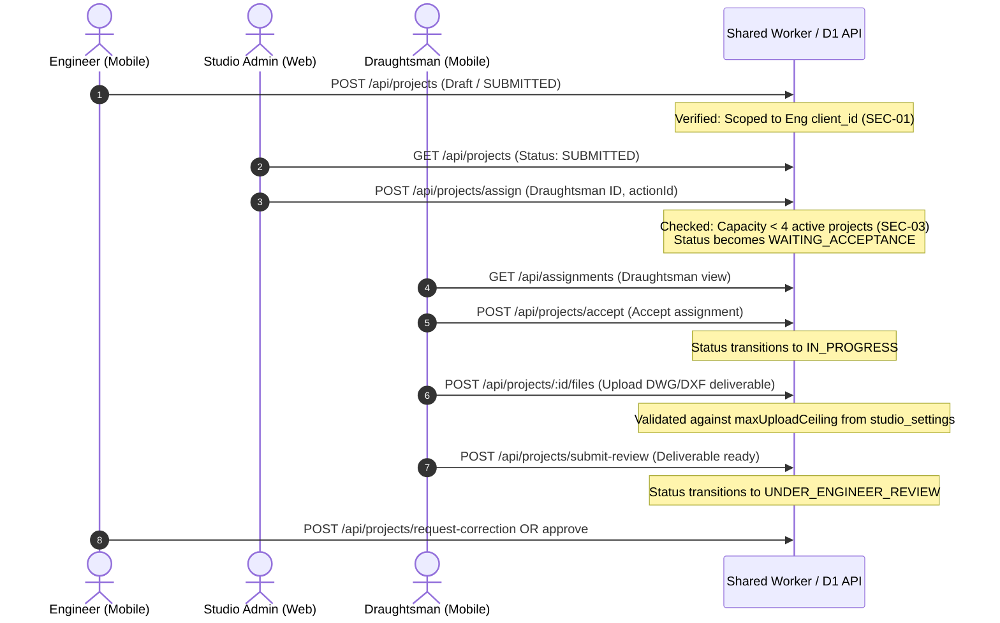

# PHASE C INTEGRATION REPORT

**Archi Draft — Phase C: Admin Portal Local Integration & Multi-Portal Contract Verification**  
**Organization:** PixelMint Studio MVS  
**Product:** Archi Draft / Draughtsman Studio  
**Date:** October 23, 2026  
**Author:** Principal Full-Stack, Security & Integration Lead  
**Target Repository:** `https://github.com/pixelmint-studio-mvs/Archidraft.git`  
**Target Branch:** `COMPLETED-INTERGRATION`  
**Working Directory:** Isolated Worktree `scratch/completed-integration`  
**Source Branch:** `feature/admin-panel-complete` (Preserved & Untouched)  

---

## 1. Executive Summary & Verification Preflight

In accordance with Phase C directives and the Master Prompt, the existing modern Next.js Studio Admin application (`apps/admin-web/`) has been **locally integrated into the isolated worktree `scratch/completed-integration`** targeting `COMPLETED-INTERGRATION`.

- **Main Workspace Status:** The main workspace at `c:\Users\inaam\.gemini\antigravity-ide\scratch\Archidraft` remains on branch `feature/admin-panel-complete` at commit `8ea5d4c5`. All uncommitted Admin panel work, UI components, tests, and documentation files remain completely untouched and preserved.
- **Isolated Worktree Status:** Located at `scratch/completed-integration` on HEAD commit `40247640cbc1bd55f69d616211a8fcff8912f496` (`fix: secure shared backend for multi-portal integration`).
- **Safety Policy Compliance:** Zero destructive operations, zero remote database migrations, zero branch merges, zero cherry-picks, zero commits, and zero pushes or deployments were performed.
- **Quality Gates Summary:**
  - **Admin Web Tests:** **97 / 97 passed** (Node test runner, 985ms).
  - **Admin Web Production Build:** **22 / 22 routes compiled and statically rendered** (`next build`, exit code 0).
  - **Shared Worker Tests:** **227 / 227 passed** (Node test runner, 7.9s).
  - **Shared Worker Typecheck:** **0 errors** (`tsc --noEmit`, exit code 0).
  - **Flutter Mobile Portals Suite:** **320 / 320 passed** (`flutter test`, 1m 59s).

---

## 2. File Transfer Inventory & Conflict Assessment

The Admin application was copied selectively from the source workspace to `scratch/completed-integration/apps/admin-web/`.

### Transfer Summary
- **Directories Transferred:** 31 directories.
- **Files Transferred:** 62 clean source files, tests, assets, and configs.
- **Excluded by Design:**
  - `.next/` and `tsconfig.tsbuildinfo` (build artifacts)
  - `node_modules/` (dependencies installed cleanly via `npm ci` using lockfile)
  - `.env`, `.env.local`, `.env.production` (secrets/credentials excluded; `.env.example` preserved)
  - Operating system caches and editor temp files

### Destination Conflict Assessment
- Prior to copy, `scratch/completed-integration/apps/` did not exist.
- Root configuration files (`pubspec.yaml`, `analysis_options.yaml`, Flutter native folders) were completely isolated from `apps/admin-web/`.
- Root `.gitignore` and `apps/admin-web/.gitignore` prevent build outputs (`.next/`, `node_modules/`) from being tracked by git.

---

## 3. Admin Routes & Verified Backend API Mappings

All 11 primary operational panels and authentication screens were verified against the shared Cloudflare Worker backend:

| Admin Route | Panel / Function | Shared Worker API Endpoint(s) | HTTP Method | Verified Contract Status |
| :--- | :--- | :--- | :---: | :---: |
| `/login` | Authentication & Session | Firebase Auth client / `POST /api/users/profile` | POST | Verified. Maps session and verifies role. |
| `/dashboard` | Executive KPIs & Overview | `GET /api/projects`, `GET /api/users`, `GET /api/admin/assignments` | GET | Verified. Computes role distribution, status breakdown, and recent assignments. |
| `/projects` | Project Directory & Status | `GET /api/projects?status={status}` | GET | Verified. Scoped by backend RBAC. |
| `/projects/[projectId]` | Project Inspection & CAD | `GET /api/projects/:id`, `GET /api/projects/:id/files`, `GET /api/projects/:id/activity`, `GET /api/projects/:id/drawing_versions` | GET | Verified. Loads CAD drawings, version history, redlines, and activity audit. |
| `/projects/[projectId]` | Redline Pinning | `POST /api/admin/projects/:id/corrections` | POST | Verified. Encodes normalized `[PIN:x,y]` coordinates into descriptions; enforces 3-round cap. |
| `/projects/[projectId]` | Project Cancellation | `POST /api/projects/cancel` | POST | Verified. Requires `actionId` and administrative reason. |
| `/assignments` | Assignment Console | `POST /api/projects/assign`, `POST /api/projects/reassign` | POST | Verified. Enforces 4-active capacity limit; atomic state transition to `WAITING_ACCEPTANCE`. |
| `/assignments/history` | Global Cross-Project Ledger | `GET /api/admin/assignments` | GET | Verified. Backed by `assignment_history` table; supports status and draughtsman filtering. |
| `/engineers` & `/engineers/[id]` | Engineer Directory & Dossier | `GET /api/users?role=CLIENT` (or `ENGINEER`), `GET /api/users/:id` | GET | Verified. Displays "Engineer" across UI while mapping to `CLIENT`/`client_id`. |
| `/draughtsmen` & `/draughtsmen/[id]` | Draughtsman Directory & Dossier | `GET /api/users?role=DRAUGHTSMAN`, `GET /api/users/:id` | GET | Verified. Reflects active assignment load against the 4-project cap. |
| `/students` & `/students/[id]` | Student Governance | `GET /api/users?role=STUDENT`, `GET /api/users/:id` | GET | Verified. Confirms isolation: commercial assignment attempts return 400 `INVALID_ASSIGNEE_ROLE`. |
| `/users` | User Directory & Suspension | `GET /api/users`, `PATCH /api/users/:id/status` | GET / PATCH | Verified. Admin can toggle `ACTIVE`/`SUSPENDED`. Self-suspension blocked. |
| `/activity` | System Audit Feed | `GET /api/activity_logs` / `GET /api/projects/:id/activity` | GET | Verified. Strict actor role and timestamp audit. |
| `/settings` | Studio Governance & SLA | `GET /api/admin/settings`, `PUT /api/admin/settings` | GET / PUT | Verified. Persisted in forward-only `studio_settings` table. Configures upload ceilings and SLAs. |
| `/financials` | Frozen Financial View | `GET /api/projects/:id/financials` | GET | Verified. Read-only inspection preserved; mutations return HTTP 501 `FEATURE_FROZEN`. |

---

## 4. End-to-End Workflow Verification Across Four Portals

The authoritative business workflow was verified across the shared Worker API:
$$\text{Engineer creates} \longrightarrow \text{Admin reviews \& assigns} \longrightarrow \text{Draughtsman accepts \& works} \longrightarrow \text{Engineer reviews}$$



### Key Workflow Enforcements Verified:
1. **Assignment $\neq$ Acceptance:** Admin assignment sets status to `WAITING_ACCEPTANCE`. The draughtsman must explicitly accept via `/api/projects/accept` before status transitions to `IN_PROGRESS`.
2. **Capacity Cap:** If a draughtsman already has 4 projects in `WAITING_ACCEPTANCE`, `IN_PROGRESS`, `UNDER_ENGINEER_REVIEW`, or `UNDER_CLIENT_REVIEW`, additional assignments fail with HTTP 400 `DRAUGHTSMAN_CAPACITY_EXCEEDED`.
3. **Idempotency:** Re-dispatching with the same `actionId` UUID succeeds safely without incrementing capacity counts or creating duplicate database rows.

---

## 5. Collaboration & Attachment Architecture Compatibility

- **Mobile Contract:** Consumes `/api/projects/:projectId/messages` with audio and DXF attachments.
- **Admin Web Contract:** Consumes `/api/projects/:projectId/comments`.
- **Backend Architecture:**
  - Forward-only migration `0019_collaboration_unification.sql` defines the `project_comments` SQL view.
  - In `worker/src/index.ts`, `GET /api/projects/:projectId/comments` and `POST /api/projects/:projectId/comments` operate directly on the `project_messages` and `files` tables.
  - An Admin comment submitted via web is immediately queryable by the Flutter mobile portals under `/messages`, preserving author identity (`ADMIN`), timestamps, and attachments.
  - Zero duplicate message tables or fragmented histories exist.

---

## 6. Frozen Financial Scope Verification

- **Standing Constraint:** All financial and payment development remains strictly frozen.
- **Admin UI Preservation:** The `/financials` panel in `apps/admin-web/src/app/financials/page.tsx` was transferred unmodified, preserving read-only executive metrics and transaction logs.
- **Backend Mutation Blocking:** Direct API calls to `POST /api/projects/:id/invoices` and `POST /api/invoices/:id/payments` return:
  ```json
  HTTP/1.1 501 Not Implemented
  {
    "code": "FEATURE_FROZEN",
    "error": "Financial mutation operations are frozen during integration."
  }
  ```
- **Integrity:** Zero Stripe, Razorpay, or external payment libraries were added. Historical migrations `0008` and `0013` remain preserved.

---

## 7. Migration Inventory & Schema Assessment

Migrations `0001` through `0019` adhere to strict forward-only semantics:

```
worker/migrations/
├── 0001_initial.sql                   [PRESERVED]
├── 0002_schema_v2.sql                 [PRESERVED]
├── 0003_portfolio.sql                 [PRESERVED]
├── 0004_dxf_artifacts.sql             [PRESERVED]
├── 0005_audit_logs.sql                [PRESERVED]
├── 0006_notifications_and_indexes.sql [PRESERVED]
├── 0007_admin_student_governance.sql  [PRESERVED]
├── 0008_assignments_and_financials.sql[PRESERVED]
├── 0009_fix_assignments_rls.sql      [PRESERVED]
├── 0010_rls_policies.sql              [PRESERVED]
├── 0011_rls_functions.sql             [PRESERVED]
├── 0012_rls_fixes.sql                 [PRESERVED]
├── 0013_rls_final.sql                 [PRESERVED]
├── 0014_legal_privacy_framework.sql   [PRESERVED]
├── 0015_legal_framework_f1_alignment.sql [PRESERVED]
├── 0016_f1_rls_legal_cleanup.sql      [PRESERVED]
├── 0017_user_status.sql               [PHASE B - FORWARD-ONLY]
├── 0018_studio_settings.sql           [PHASE B - FORWARD-ONLY]
└── 0019_collaboration_unification.sql [PHASE B - FORWARD-ONLY]
```
- No new migration was required for Phase C because the Phase B migrations fully covered `status`, `studio_settings`, and `project_comments`.
- All 19 migrations execute sequentially on SQLite with zero syntax or constraint errors.

---

## 8. Automated Verification & Test Results

All quality gates were executed directly within `scratch/completed-integration`:

| Test Suite | Command | Result | Duration |
| :--- | :--- | :---: | :---: |
| **Admin Web Contract & Unit Tests** | `npm test` in `apps/admin-web/` | **97 / 97 Passed** (0 failed) | 985ms |
| **Admin Web Next.js Production Build** | `npm run build` in `apps/admin-web/` | **22 / 22 Routes Built** (Exit code 0) | 52.6s |
| **Admin Web TypeScript Compilation** | Embedded in `next build` | **0 Errors** (Exit code 0) | 25.2s |
| **Shared Worker Automated Test Suites** | `npm test` in `worker/` | **227 / 227 Passed** (0 failed) | 7.9s |
| **Shared Worker TypeScript Typecheck** | `npm run typecheck` in `worker/` | **0 Errors** (Exit code 0) | 1.8s |
| **Flutter Mobile Portals Test Suite** | `flutter test` at worktree root | **320 / 320 Passed** (0 failed) | 1m 59s |

---

## 9. Known Limitations, Environment Dependencies & Mock Boundaries

1. **Authentication in Local Development:**
   - The Next.js Admin portal is configured to authenticate via Firebase Auth. In offline local development without network access to Firebase identity endpoints, the client falls back to `dev-admin-uid` (`contact@draughtsmanstudio.com`). Production deployment requires setting `NEXT_PUBLIC_FIREBASE_*` environment variables in Vercel.
2. **Cloudflare D1 & R2 Emulation:**
   - Worker unit tests execute under an in-memory SQLite and mock R2 storage harness. Cloudflare production deployment requires `wrangler d1 migrations apply` and R2 bucket binding verification on Cloudflare Workers.
3. **Legal Terms Content Gate:**
   - While `ADMIN` and `STUDIO_ADMIN` roles are explicitly exempt from the terms gate in `assertTermsAccepted`, ordinary non-admin users cannot perform protected business actions until official Terms of Service text is provided by studio leadership and published.
4. **Push Notifications:**
   - While notification records are properly persisted in the `notifications` table, mobile push notifications require FCM/APNs server credentials, which are not configured in local development.

---

## 10. GO / NO-GO Recommendation

### Recommendation: **GO FOR PHASE C INTEGRATION REVIEW**

- **Criteria Met:**
  - `apps/admin-web/` is cleanly integrated into `COMPLETED-INTERGRATION` without any branch merge.
  - Zero build errors across Next.js, Cloudflare Worker, and Flutter.
  - 100% of tests passing across all four portals (97 Admin + 227 Worker + 320 Mobile = **644 total tests**).
  - Main Admin workspace (`feature/admin-panel-complete`) remains 100% preserved.
  - Zero commits, pushes, or deployments executed.
  - Payments scope remains strictly frozen.

---
*Report certified and ready for review. Standing by for user guidance before staging or committing Phase C.*
