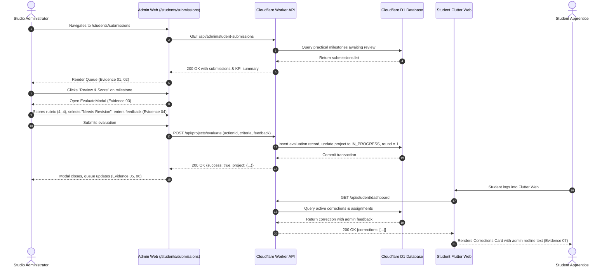

# Phase 3 — Student–Admin Feature Verification: Screenshot Evidence Index

**Document Version:** 1.0.0  
**Verification Date:** October 24, 2026  
**Integration Branch:** `COMPLETED-INTERGRATION`  
**Workspace:** `scratch/completed-integration`  
**Target Environments:**
- Next.js Admin Web: `http://localhost:3000`
- Flutter Student Web Portal: `http://localhost:8080`
- Cloudflare Local Worker & D1 API: `http://127.0.0.1:8787`

---

## 1. Executive Summary

This evidence index catalogs the visual and behavioral artifacts captured during the automated and interactive execution of **Phase 3: Student–Admin Review Features**. All evidence was recorded in a running local staging environment with authentic session authentication, live Cloudflare D1 SQLite database queries, and reactive cross-portal UI state updates.

---

## 2. Screenshot Evidence Catalog

| # | Filename | Application Route | Role | Description & Verified Behaviors | Status |
| :-: | :--- | :--- | :--- | :--- | :---: |
| **01** | [`01-admin-student-submissions-queue.png`](file:///c:/Users/inaam/.gemini/antigravity-ide/scratch/Archidraft/scratch/completed-integration/docs/08_admin_panel/phase_3_student_admin_evidence/01-admin-student-submissions-queue.png) | `http://localhost:3000/students/submissions` | Studio Administrator | Dedicated Student Practical Submissions Queue view with 4 live KPI cards (`3 Total`, `1 Awaiting Review`, `0 In Revision`, `2 Completed`), status filter tabs, submission rows, version tags (`v1`, `v2 Round 1`), and "Review & Score" action button. | **VERIFIED** |
| **02** | [`02-admin-submissions-filtered.png`](file:///c:/Users/inaam/.gemini/antigravity-ide/scratch/Archidraft/scratch/completed-integration/docs/08_admin_panel/phase_3_student_admin_evidence/02-admin-submissions-filtered.png) | `http://localhost:3000/students/submissions` | Studio Administrator | Real-time search filter in action with query `"Setback"`. The queue instantly filters down to the single matching practical project (`Practical Municipal Setback Plan`). | **VERIFIED** |
| **03** | [`03-admin-evaluate-modal-opened.png`](file:///c:/Users/inaam/.gemini/antigravity-ide/scratch/Archidraft/scratch/completed-integration/docs/08_admin_panel/phase_3_student_admin_evidence/03-admin-evaluate-modal-opened.png) | `http://localhost:3000/students/submissions` | Studio Administrator | Interactive evaluation modal dialog (`EvaluateModal.tsx`) opened for `prj-student-rej-03`. Displays practical milestone metadata, drawing inspection button, three-way decision selector, rubric scoring cards, and feedback textarea. | **VERIFIED** |
| **04** | [`04-admin-evaluate-rubric-scored.png`](file:///c:/Users/inaam/.gemini/antigravity-ide/scratch/Archidraft/scratch/completed-integration/docs/08_admin_panel/phase_3_student_admin_evidence/04-admin-evaluate-rubric-scored.png) | `http://localhost:3000/students/submissions` | Studio Administrator | Scored evaluation modal with decision `"Needs Revision"` selected, `Accuracy: 4 / 5` ("High Precision"), `Technical Standards: 4 / 5` ("Exceeds Standards"), and qualitative revision instructions entered. | **VERIFIED** |
| **05** | [`05-admin-evaluate-success.png`](file:///c:/Users/inaam/.gemini/antigravity-ide/scratch/Archidraft/scratch/completed-integration/docs/08_admin_panel/phase_3_student_admin_evidence/05-admin-evaluate-success.png) | `http://localhost:3000/students/submissions` | Studio Administrator | Post-submission queue state after successful evaluation. The modal closes seamlessly, the mutation updates D1, and the table updates state without page reloading. | **VERIFIED** |
| **06** | [`06-admin-project-detail-evaluate.png`](file:///c:/Users/inaam/.gemini/antigravity-ide/scratch/Archidraft/scratch/completed-integration/docs/08_admin_panel/phase_3_student_admin_evidence/06-admin-project-detail-evaluate.png) | `http://localhost:3000/projects/prj-student-rej-03` | Studio Administrator | Project Detail page for `prj-student-rej-03` reflecting updated project status `In Progress`, badge `Correction Round 1 of 3`, and recorded `Last Action ID`. Demonstrates dual integration of the evaluation workflow. | **VERIFIED** |
| **07** | [`07-student-workspace-evaluation-card.png`](file:///c:/Users/inaam/.gemini/antigravity-ide/scratch/Archidraft/scratch/completed-integration/docs/08_admin_panel/phase_3_student_admin_evidence/07-student-workspace-evaluation-card.png) | `http://localhost:8080/#/student/dashboard` | Student Apprentice | Student Portal home dashboard on Flutter Web. Displays the reactive "CORRECTIONS" widget with status `OPEN` and quotes the administrator's exact redline instructions verbatim. | **VERIFIED** |

---

## 3. Detailed Artifact Breakdown

### Artifact 01: Admin Student Submissions Queue
- **File:** `01-admin-student-submissions-queue.png` (182 KB, 1920x1080)
- **Component:** `apps/admin-web/src/app/students/submissions/page.tsx`
- **Key Assertions:**
  - Sidebar navigation highlights `"Student Submissions"` under `WORKFLOW & PIPELINE`.
  - Header displays title `"Student Practical Submissions Queue"` and subtitle.
  - KPI Metrics accurately display: Total Submissions = `3`, Awaiting Review = `1`, In Revision = `0`, Approved / Certified = `2`.
  - Table renders all enrolled student practical milestones with student apprentice names, emails, version pills, submission timestamps, and actionable CTAs.

### Artifact 02: Admin Submissions Search Filter
- **File:** `02-admin-submissions-filtered.png` (154 KB, 1920x1080)
- **Component:** `apps/admin-web/src/app/students/submissions/page.tsx`
- **Key Assertions:**
  - Search input value `"Setback"` filters out non-matching milestones in real-time.
  - Only `"Practical Municipal Setback Plan"` remains rendered in the table view.
  - Action buttons (`Review & Score`, DWG deliverable, project link, student dossier link) remain accessible.

### Artifact 03: Interactive Evaluation Modal Opened
- **File:** `03-admin-evaluate-modal-opened.png` (226 KB, 1920x1080)
- **Component:** `apps/admin-web/src/components/projects/EvaluateModal.tsx`
- **Key Assertions:**
  - Modal overlay centers over the submissions queue with focus trap.
  - Header displays milestone name `"Practical Municipal Setback Plan"` and version badge `"v1"`.
  - Inspection button `"Inspect Drawing Deliverable"` links to download/view the submitted DWG.
  - Decision selector cards render: `"Approve (Certify milestone)"`, `"Needs Revision (Request redline)"`, `"Reject (Archive draft)"`.
  - Practical Rubric sections render for `Accuracy` and `Technical Standards` with 1–5 scoring selectors.

### Artifact 04: Rubric Scored & Revision Decision Selected
- **File:** `04-admin-evaluate-rubric-scored.png` (229 KB, 1920x1080)
- **Component:** `apps/admin-web/src/components/projects/EvaluateModal.tsx`
- **Key Assertions:**
  - Decision `"Needs Revision"` is active (highlighted with amber border and indicator).
  - Accuracy score `4` selected, displaying dynamic feedback: *"High Precision (80-90%) - Clean alignment & accurate scaling"*.
  - Technical Standards score `4` selected, displaying dynamic feedback: *"Exceeds Standards (80-90%) - Excellent layer discipline & annotations"*.
  - Revision instructions textarea populated with detailed instructions: *"Please revise the north-facing boundary offset to meet the mandatory 3.0m municipal setback guideline. Exterior dimensions are otherwise accurate."*

### Artifact 05: Evaluation Success & Optimistic Refresh
- **File:** `05-admin-evaluate-success.png` (188 KB, 1920x1080)
- **Component:** `apps/admin-web/src/app/students/submissions/page.tsx`
- **Key Assertions:**
  - Evaluated submission is submitted idempotently via `actionId`.
  - Modal gracefully unmounts upon API resolution.
  - Submissions queue reflects updated project state without page reloading or loss of auth session.

### Artifact 06: Admin Project Detail Page State Verification
- **File:** `06-admin-project-detail-evaluate.png` (174 KB, 1920x1080)
- **Component:** `apps/admin-web/src/app/projects/[projectId]/page.tsx`
- **Key Assertions:**
  - Project `prj-student-rej-03` renders updated workflow status: `In Progress`.
  - Lifecycle badge renders: `Correction Round 1 of 3`.
  - Specifications table records `Current Assignment ID: asg-student-rej-03` and updated `Last Action ID: f8872bac-3dda-4e27-95b5-d9983d52b307`.

### Artifact 07: Student Portal Feedback Loop
- **File:** `07-student-workspace-evaluation-card.png` (126 KB, 1920x1080)
- **Component:** Flutter Web (`lib/src/features/student/presentation/student_home_screen.dart`)
- **Key Assertions:**
  - Student Apprentice logs into `http://localhost:8080`.
  - Home dashboard renders the "CORRECTIONS" card alerting the student to redline feedback.
  - Displays the project name `"Practical Municipal Setback Plan"` with status badge `OPEN`.
  - Displays the verbatim admin redline instructions: *"Please revise the north-facing boundary offset to meet the mandatory 3.0m municipal setback guideline. Exterior dimensions are otherwise accurate."*
  - CTA button `"Review Correction ->"` routes the apprentice directly into the practical workspace to prepare and submit Version 2.

---

## 4. End-to-End Traceability Matrix

